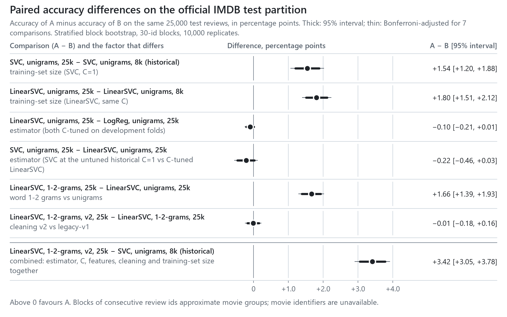
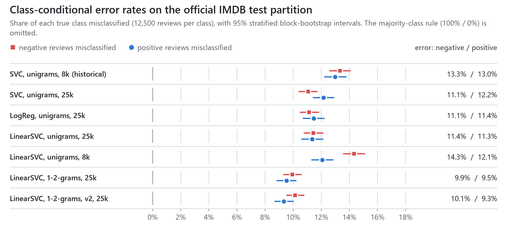
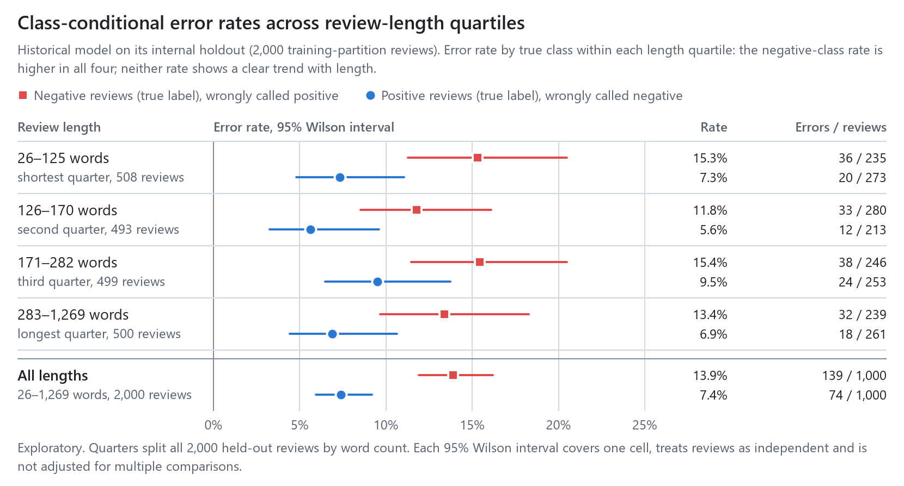
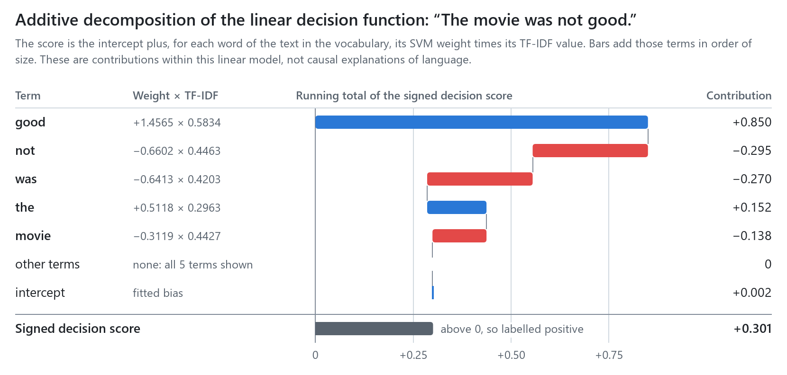
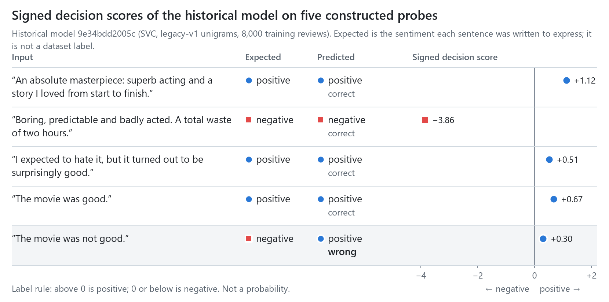

# TF-IDF linear sentiment classifiers on the official IMDB test partition: a controlled comparison

[](https://github.com/easensoy/sentiment-analyzer/actions/workflows/python-ci.yml)

**Research question.** On the official IMDB test partition (Maas et al., 2011), how do TF-IDF linear classifiers differ in accuracy and class-conditional error when the estimator, the feature representation, the text-cleaning version and the training-set size are changed one at a time, and how does the repository's historical model compare?

**Status, 2026-11-08.** *Completed:* development-only model selection on the official training partition; a protocol freeze pushed before any test scoring ([`387779a`](https://github.com/easensoy/sentiment-analyzer/commit/387779a), locked in [`7112e22`](https://github.com/easensoy/sentiment-analyzer/commit/7112e22)); one scoring of eight frozen candidates on the 25,000 official test reviews; paired block-bootstrap comparisons; duplicate and overlap audits; versioned Pipeline artefacts with validated manifests. *Provisional:* a 237-case behavioural suite whose labels no person has adjudicated. *Not executed:* the Claude baseline (runner implemented and validated offline; no spending limit has been set).

[Principal findings](#principal-findings) · [Configuration](#experimental-configuration) · [Results](#results-on-the-official-test-partition) · [Behavioural suite](#behavioural-suite-provisional-labels-not-adjudicated) · [Reproduction](#reproduction) · [Model card](#model-card) · [Limitations](#methodological-limitations) · [Phone-width figures](docs/narrow-figures.md)

## Principal findings

<picture>
  <source media="(min-width: 960px) and (prefers-color-scheme: dark)" srcset="visual_outputs/09_paired_differences_dark.png">
  <source media="(max-width: 959px) and (prefers-color-scheme: dark)" srcset="visual_outputs/09_paired_differences_narrow_dark.png" width="360">
  <source media="(max-width: 959px)" srcset="visual_outputs/09_paired_differences_narrow_light.png" width="360">
  
</picture>

Empirical findings on the 25,000 official test reviews; intervals are 95% stratified block-bootstrap percentile intervals unless stated otherwise.

1. **The historical model is weaker on the official test partition than its internal holdout indicated.** The same artefact scores 86.85% accuracy (86.32–87.37%), against 89.35% (87.92–90.63%, Wilson) on its internal holdout. Its class-conditional error rates are 13.32% for negative and 12.98% for positive reviews: the 6.5-point asymmetry measured internally (13.9% vs 7.4%) is not reproduced (difference +0.34 points, −0.72 to +1.38; exploratory, post hoc).
2. **Training-set size and word bigrams each add about 1.5–1.8 points; the estimator and the cleaning version add nothing detectable.** Training on all 25,000 instead of 8,000 reviews adds +1.54 points for SVC at C=1 (+1.20 to +1.88) and +1.80 for LinearSVC at fixed C (+1.51 to +2.12). Word 1–2-grams add +1.66 over unigrams (+1.39 to +1.93). LinearSVC and logistic regression differ by −0.10 (−0.21 to +0.01), and the untuned SVC and LinearSVC by −0.22 (−0.46 to +0.03). Cleaning v2 changes accuracy by −0.01 (−0.18 to +0.16), although it led legacy-v1 by 0.22 points on development folds. The two size effects, the bigram effect and the combined difference in finding 3 also exclude zero under Bonferroni adjustment for the seven comparisons.
3. **The development-selected final model gains 3.42 points over the historical model.** `linsvc_bi_v2_full`, named the final model by the frozen protocol from development accuracy alone, reaches 90.26% (89.80–90.70%), +3.42 points over the historical model (+3.05 to +3.78). This is a combined change of estimator, regularisation, features, cleaning and training-set size; findings 2 attribute its parts.
4. **Errors concentrate near the rating boundary.** For the final model, 21.4% of reviews rated 4 and 18.9% of those rated 7 are misclassified, against 4.7% at rating 1 and 6.0% at rating 10 (pre-specified rating slices; `results/official_test/slices.csv`). Class-conditional error rates differ by less than 1 point for the final model (10.14% vs 9.34%).

These estimates characterise the official test partition, whose movies are disjoint from the training partition's. They are not comparable with published results that use other training sets, preprocessing or protocols.

## Experimental configuration

| Component | Specification |
|---|---|
| Data | Large Movie Review Dataset v1.0: official training and test partitions, 25,000 reviews each, 12,500 per class; star ratings 1–4 (negative) and 7–10 (positive); reviews rated 5–6 are absent by construction. |
| Sources | fast.ai mirror of the aclImdb archive (review ids, ratings) and Hugging Face `stanfordnlp/imdb` parquet files at revision `e6281661`; both pinned by SHA-256, with identical (text, label) multisets per partition. |
| Development | Official training partition only: five folds of 100-id blocks per label (2,500 reviews per class per fold); the vectoriser is refitted inside each training fold; C is chosen by the highest mean validation accuracy, ties to the smaller C. |
| Final evaluation | Official test partition, scored once, after the protocol freeze. |
| Features | `TfidfVectorizer` with scikit-learn defaults (raw term frequency, smoothed IDF, L2 normalisation) over word unigrams or word 1–2-grams, `min_df=1`, after cleaning version `legacy-v1` or `v2`. |
| Estimators | `SVC(kernel="linear")`, `LinearSVC` (squared hinge loss), `LogisticRegression` (liblinear), majority class. |
| Training sets | All 25,000 training reviews, or the historical model's 8,000 (a subset of the same partition). |
| Uncertainty | Stratified block bootstrap over review-id order, 30 ids per block within each label, 10,000 replicates, percentile intervals; example-level and 60-id blocks as sensitivity analyses. |

Cleaning `legacy-v1` reproduces the historical path: `<br />` tags become spaces, then every character other than ASCII letters and whitespace is deleted and the text lower-cased. Cleaning `v2` decodes HTML entities and removes tags, folds accents (NFKD), expands *n't* to *not*, replaces rather than deletes punctuation, and keeps digits. Both are implemented once in `src/cleaning.py` and applied inside the served Pipeline, so training and serving share one path.

## Method

Each candidate maps a review $x$ to a signed decision score

$$f(x) = \mathbf{w}^\top \phi(x) + b,$$

where $\phi(x)$ is the L2-normalised TF-IDF vector of the cleaned text. The label is $\hat y = \mathbb{1}[f(x) > 0]$; an exact zero is negative. For the linear-kernel SVC, $\mathbf{w} = \sum_i \alpha_i y_i \phi(x_i)$ over the support vectors, so every candidate's score is linear in $\phi(x)$ and decomposes exactly into per-term contributions $w_j \phi_j(x)$ plus $b$ (figure 08).

For predictions on the $n_c$ test reviews of true class $c$, the class-conditional error rate is

$$e_c = \frac{1}{n_c} \sum_{i:\, y_i = c} \mathbb{1}[\hat y_i \neq c].$$

For a paired comparison of candidates A and B on the same reviews, the estimand is $\Delta = \mathrm{acc}_A - \mathrm{acc}_B$. Each bootstrap replicate $b$ draws, within each label, as many 30-id blocks as that label has, with replacement, and evaluates both candidates on the same multiset of reviews, giving $\Delta^{*}_b$; the 95% interval is the 2.5th to 97.5th percentile of $\{\Delta^{*}_b\}_{b=1}^{10\,000}$.

Movie identifiers are not available from any reachable source: the archive mirror omits the `urls_*.txt` files, and the canonical host did not respond. Review ids are, however, ordered by movie within each directory. The mean TF-IDF cosine between reviews with adjacent ids is 0.092–0.129, against 0.035–0.038 for random pairs, and it decays to the random level by a lag of 20–30 ids (`results/data/duplicate_audit.json`). Blocks of 30 consecutive ids, the dataset's cap on reviews per movie, therefore approximate movie clusters; a movie that straddles a block boundary is split across two blocks, so some dependence remains. The two partitions contain disjoint sets of movies, as the dataset's README states.

## Results on the official test partition

All rows score the same 25,000 official test reviews (12,500 per class). Intervals are 95% stratified block-bootstrap percentile intervals. Data: [`results/official_test/metrics.csv`](results/official_test/metrics.csv); per-review scores and labels: [`predictions.csv.gz`](results/official_test/predictions.csv.gz).

<!-- table:results -->
<!-- /table:results -->

<picture>
  <source media="(min-width: 960px) and (prefers-color-scheme: dark)" srcset="visual_outputs/10_class_error_rates_dark.png">
  <source media="(max-width: 959px) and (prefers-color-scheme: dark)" srcset="visual_outputs/10_class_error_rates_narrow_dark.png" width="360">
  <source media="(max-width: 959px)" srcset="visual_outputs/10_class_error_rates_narrow_light.png" width="360">
  
</picture>

Asymmetry between the two class-conditional error rates depends on the model rather than being a stable property of the task. In an exploratory, post hoc analysis ([`exploratory_class_asymmetry.csv`](results/official_test/exploratory_class_asymmetry.csv)), $e_{\text{neg}} - e_{\text{pos}}$ is +2.26 points (+1.21 to +3.34) for LinearSVC trained on the historical 8,000 reviews, −1.10 (−2.08 to −0.14) for the SVC trained on all 25,000, and indistinguishable from zero for the other trained candidates.

### Paired comparisons

Each row compares two candidates that differ in the named factor only, except the last, which combines all factors and is attributable to none of them alone. Positive values favour A. Data: [`paired_differences.csv`](results/official_test/paired_differences.csv), which also holds macro F1 and class-conditional differences.

<!-- table:paired -->
<!-- /table:paired -->

The resampling unit hardly changes the intervals: example-level, 30-id and 60-id intervals agree to within 0.03 points at either end. Either the 30-id blocks capture little of the remaining dependence, or paired differences are insensitive to it; the data cannot distinguish the two.

### Sensitivity to train–test overlap

123 test reviews occur verbatim in the training partition, and one more exceeds a TF-IDF cosine of 0.9 to a training review. Removing these 124 changes no accuracy by more than 0.13 points (the majority-class rule) and no trained candidate's by more than 0.05. Every paired difference keeps its sign and moves by at most 0.04 points ([`overlap_sensitivity.csv`](results/official_test/overlap_sensitivity.csv)).

<!-- table:overlap -->
<!-- /table:overlap -->

## Development-set selection

Selection used the official training partition only. LinearSVC became the branch estimator for the feature and cleaning comparisons because its unigram development accuracy exceeded logistic regression's, and the frozen protocol named `linsvc_bi_v2_full` the final model, by the highest development accuracy among the C-tuned candidates, before any test score existed. Data: [`results/dev/`](results/dev/).

<!-- table:development -->
<!-- /table:development -->

Logistic regression's selected C lies at the upper edge of its grid for 1–2-gram features; no frozen candidate uses those settings. The linear-kernel SVC was not tuned: one fit on 20,000 reviews took about 19 minutes on this machine.

The ablation removes one component of cleaning v2 at a time (development folds only). No component moves mean accuracy by more than 0.06 points, which is small against the fold-to-fold standard deviation of about 1.1 points.

<!-- table:ablation -->
<!-- /table:ablation -->

## Behavioural suite (provisional: labels not adjudicated)

The suite holds 237 constructed sentences in minimal pairs, label-preserving sets and single cases ([`behavioural/`](behavioural/)). An AI assistant proposed every label, and no person has reviewed them. These results are therefore excluded from the principal findings, and they do not estimate error rates on natural reviews. Template groups are assigned whole to development or held-out families; the table reports the held-out families. A unit (pair, set or single case) fails if any member is mislabelled. Each cell gives the failure rate in percent, failed/total units, and a 95% family-level bootstrap interval. Data: [`failure_rates.csv`](results/behavioural/failure_rates.csv); adjudication queue: [`annotation_queue_v1.csv`](behavioural/annotation_queue_v1.csv).

<!-- table:behavioural -->
<!-- /table:behavioural -->

On the held-out families, every trained candidate fails 81–89% of negation units and 75–88% of contrast units, and none fails an intensity unit. Sarcasm failure ranges from 40% to 80% over only 10 units in 4 families, too few to rank candidates. The majority-class rule fails every unit that has a positive member, which gives a reference level for each phenomenon.

**Architectural property, not a measurement.** The development family `con-but` pairs sentences that are word permutations of each other ("The acting was great, but overall the film was dull." / "The acting was dull, but overall the film was great."). Under both cleaning versions the two members have identical token multisets, hence identical unigram TF-IDF vectors and identical scores, so every unigram candidate fails such pairs by construction. Word bigrams make the members distinguishable but do not guarantee the correct order of evidence.

## Computational cost and latency

Wall-clock times on one laptop CPU (Intel Core Ultra 7 165H, 16 cores, 31.5 GB). Fits ran alongside other jobs, so their times indicate scale only. Batch scoring covers cleaning, TF-IDF and the decision function for all 25,000 test reviews in one call. Single-request latency repeats that path for one review at a time over a fixed sample of 1,000 reviews, excluding HTTP handling. The historical model's fit time is that of the `train.py` re-fit; the original run took 67.4 s. Data: [`inference.csv`](results/official_test/inference.csv), [`results/study/fits/`](results/study/fits/).

<!-- table:cost -->
<!-- /table:cost -->

No Claude model has been run, so this repository contains no LLM accuracy, token count, cost or latency. The runner in [`study/llm/`](study/llm/) is complete and validated offline, and a live run requires an explicit `--max-spend-usd`. For the frozen 2,000-review subset with four few-shot exemplars, the runner's conservative pre-flight bound, which prices every response at the 1,024-token output cap, is $1.38 for Claude Haiku 5.5, $27.51 for Claude Sonnet 5.5 and $55.02 for Claude Opus 5.5 in online mode, and half that in batch mode. These are upper bounds, not measurements. Public IMDB reviews are widely redistributed, so any LLM result here would carry an unquantified risk of training-data contamination.

## Historical results (internal holdout, protocol of 2026-11-06)

These results predate the study and keep their original protocol. The historical model (`svc_uni_8k_historical`) was fitted on 8,000 reviews and evaluated on 2,000 held-out reviews, both drawn from a 10,000-review sample of the official training partition by a stratified 80/20 split (seed 42). That split does not enforce movie-level separation, so its estimates characterise the internal partition only. Its intervals are 95% Wilson intervals, which treat reviews as independent.

On that holdout the model's accuracy is 89.35% (87.92–90.63%) and its macro F1 89.34%. Its class-conditional error rates are 13.9% for negative reviews (139/1,000; 11.9–16.2%) and 7.4% for positive reviews (74/1,000; 5.9–9.2%). The official-test estimates for the same artefact are in the results table above. The original metrics are archived unchanged in [`results/historical/metrics.json`](results/historical/metrics.json), and [`refit_equivalence.json`](results/historical/refit_equivalence.json) shows that the Pipeline re-fit equals the original artefact parameter for parameter. Figures 06–08 come from `scripts/make_readme_figures.py`; their data are in `visual_outputs/06–08_*.csv`, and the [historical run report](visual_outputs/REPORT.md) gives details.

<picture>
  <source media="(min-width: 960px) and (prefers-color-scheme: dark)" srcset="visual_outputs/07_error_by_length_dark.png">
  <source media="(max-width: 959px) and (prefers-color-scheme: dark)" srcset="visual_outputs/07_error_by_length_narrow_dark.png" width="360">
  <source media="(max-width: 959px)" srcset="visual_outputs/07_error_by_length_narrow_light.png" width="360">
  
</picture>

<picture>
  <source media="(min-width: 960px) and (prefers-color-scheme: dark)" srcset="visual_outputs/08_score_contributions_dark.png">
  <source media="(max-width: 959px) and (prefers-color-scheme: dark)" srcset="visual_outputs/08_score_contributions_narrow_dark.png" width="360">
  <source media="(max-width: 959px)" srcset="visual_outputs/08_score_contributions_narrow_light.png" width="360">
  
</picture>

The decomposition shows why the historical model labels "The movie was not good." positive. Its score, +0.301, is a sum in which the unigram *not* contributes −0.295 while *good* contributes +0.850. A unigram model assigns *not* one weight regardless of the word it negates, so it cannot represent the scope of negation. Figure 06 shows the five constructed probes behind this example; the behavioural suite measures the same construction systematically.

<picture>
  <source media="(min-width: 960px) and (prefers-color-scheme: dark)" srcset="visual_outputs/06_probe_outputs_dark.png">
  <source media="(max-width: 959px) and (prefers-color-scheme: dark)" srcset="visual_outputs/06_probe_outputs_narrow_dark.png" width="360">
  <source media="(max-width: 959px)" srcset="visual_outputs/06_probe_outputs_narrow_light.png" width="360">
  
</picture>

## Reproduction

Python 3.15 and [uv](https://docs.astral.sh/uv/); on Windows use `.venv\Scripts\python` in place of `.venv/bin/python`. The downloads total about 186 MB and are never committed.

```bash
uv venv --python 3.15
uv pip install -r requirements-dev.txt
mkdir -p data/raw/fastai-imdb data/raw/hf-imdb-e6281661
curl -L -o data/raw/fastai-imdb/imdb.tgz https://s3.amazonaws.com/fast-ai-nlp/imdb.tgz
curl -L -o data/raw/hf-imdb-e6281661/train-00000-of-00001.parquet \
  https://huggingface.co/datasets/stanfordnlp/imdb/resolve/e6281661ce1c48d982bc483cf8a173c1bbeb5d31/plain_text/train-00000-of-00001.parquet
curl -L -o data/raw/hf-imdb-e6281661/test-00000-of-00001.parquet \
  https://huggingface.co/datasets/stanfordnlp/imdb/resolve/e6281661ce1c48d982bc483cf8a173c1bbeb5d31/plain_text/test-00000-of-00001.parquet
.venv/bin/python train.py                     # historical model; publishes models/serving.json
.venv/bin/python -m study.data                # verifies both sources; writes split membership
.venv/bin/python -m study.audit               # duplicate, near-duplicate and id-order audit
.venv/bin/python -m study.develop --jobs 4    # development selection (about 10 minutes)
.venv/bin/python -m study.fit                 # frozen candidates (the SVC fit takes about 17 minutes)
.venv/bin/python -m study.protocol verify     # every locked file must match protocol/LOCK.json
.venv/bin/python -m study.evaluate score      # refuses if results/official_test/predictions.csv.gz exists
.venv/bin/python -m study.evaluate analyse
.venv/bin/python -m study.exploratory
.venv/bin/python -m study.behavioural evaluate
.venv/bin/python -m study.figures
.venv/bin/python scripts/make_readme_figures.py
.venv/bin/python -m study.report --check      # README tables must match the result files
.venv/bin/python -m pytest tests/
```

`study.evaluate score` refuses to run when a scored predictions file exists; to repeat the scoring, delete `results/official_test/predictions.csv.gz` first. Fitted artefacts and their SHA-256 values match the recorded ones only under the recorded library versions (`results/study/fits/*.json`, `results/official_test/scoring_log.json`); they have not been reproduced on a second machine.

## Provenance and integrity

- **Sources.** [`source_manifest.json`](results/data/source_manifest.json) pins the fast.ai archive (144,440,600 bytes) and the two Hugging Face parquet files by SHA-256. `study.data` stops unless the sizes, the hashes and the cross-source (text, label) multisets all agree.
- **Split membership.** [`split_membership.csv.gz`](results/data/split_membership.csv.gz) lists all 50,000 labelled reviews by `partition/class/review_id`. For each it records a 64-bit text hash, star rating, length, bootstrap block, development fold and historical role, and no review text. The historical 10,000-review sample maps onto the training partition without loss; 30 of its texts occur under more than one official id.
- **Duplicates.** Exact duplicates leave 96 redundant copies in the training partition and 199 in the test partition, none with conflicting labels. Normalisation adds no cross-partition matches beyond the 123 exact ones ([`duplicate_audit.json`](results/data/duplicate_audit.json)).
- **Freeze.** [`protocol_v1.json`](protocol/protocol_v1.json) fixed the candidates and their artefact hashes, the comparisons, metrics, resampling, slices, the overlap-exclusion rule, the LLM subset and the final-model rule. [`LOCK.json`](protocol/LOCK.json) holds the SHA-256 of every file the evaluation depends on. Both were pushed before the test partition was scored. `study.evaluate score` refuses to run unless `study.protocol verify` passes, and CI runs the same verification on every push.
- **Scoring.** [`scoring_log.json`](results/official_test/scoring_log.json) records the protocol and lock hashes, timestamps, library versions and hardware of the single scoring run. It ran at commit `88d8102`; the working tree differed from that commit only in presentation files outside the lock. No candidate, setting or pre-specified analysis changed afterwards; the class-asymmetry analysis was added after scoring and is labelled exploratory.
- **Figures and tables.** Figures 09–10 come from `study/figures.py`, figures 06–08 from `scripts/make_readme_figures.py`, each from committed CSV files. The README's tables are generated by `study/report.py`, and CI fails if they drift from the result files.

## Model card

- **Models.** The eight frozen candidates in the results table. The served default is the historical model `9e34bdd2005c`, published by `python train.py`; any study candidate under `models/study/` can be published to `models/serving.json` with `src.pipeline.publish`. Every artefact is one scikit-learn `Pipeline` (cleaning, TF-IDF, linear classifier) with a manifest recording its configuration, training-set hash, SHA-256 and library versions.
- **Intended use.** Research baseline and teaching reference for binary polarity classification of English movie reviews of review length. It also serves as a fixed reference against which other classifiers, including LLMs, can be compared on identical examples.
- **Out of scope.** Decisions about people; content moderation; domains other than film reviews; non-English, short or conversational text; mixed or neutral opinions, which the training data excludes by construction; probability estimates, since scores are uncalibrated and model-specific; inputs controlled by an adversary.
- **Evaluation.** Official IMDB test partition: 25,000 reviews, 12,500 per class. Metrics are accuracy, macro F1 and class-conditional precision, recall and error, with stratified block-bootstrap intervals. For the final model, accuracy is 90.26% (89.80–90.70%).
- **Known failure modes.** Bag-of-n-gram features carry no syntax, so negation, contrast and sarcasm reach the model only as co-occurring terms. On the provisional behavioural suite, trained candidates fail most negation and contrast units. Errors concentrate at ratings 4 and 7. Class-conditional asymmetry varies by model (figure 10). A review whose words are all out of vocabulary receives the intercept's sign in batch scoring; the API returns 422 for it instead.
- **Training data.** The official IMDB training partition (Maas et al., 2011); the historical model uses an 8,000-review subset. The data are public user reviews, and the Hugging Face dataset card lists the licence as `other`. Cite Maas et al., "Learning Word Vectors for Sentiment Analysis", ACL 2011.
- **Ethical considerations.** The reviews reflect the opinions and language of IMDB users who wrote them before 2011. Vocabulary-based models can encode associations between sentiment and named entities, genres or dialects. No fairness or subgroup analysis has been performed.

## Methodological limitations

- **Approximate grouping.** Intervals resample 30-id blocks as a proxy for movies. Movies that straddle block boundaries leave residual dependence, so intervals may remain somewhat narrow. The example-level and 60-id sensitivity intervals bracket this choice.
- **One partition, one domain.** All estimates describe English IMDB reviews with polar ratings. Mixed reviews (ratings 5–6) are excluded by the dataset's construction.
- **Lexical overlap screen only.** The duplicate audit detects exact, normalised and near-lexical overlap; paraphrased duplicates escape it.
- **Approximate development folds.** Development folds of 100-id blocks only approximate movie separation, so development estimates may be optimistic; this can affect selection but not the test estimates.
- **Untuned SVC.** The linear-kernel SVC keeps the historical C=1, so comparisons involving it confound estimator and regularisation.
- **Timing.** Fit and inference times were measured once on a shared laptop. They indicate scale, not stable throughput.
- **Synthetic behavioural suite.** The suite's labels are unadjudicated proposals by an AI assistant. Its sentences are short and templated, and its held-out sarcasm and contrast sets contain 4–5 families each.
- **Post hoc analysis.** The class-asymmetry differences were computed after scoring and are exploratory.
- **No LLM measurements.** The Claude baseline has not been run, so no LLM claim of any kind is made.

## API

`POST /predict` takes `{"text": "..."}` and returns `label`, `sentiment` (0 or 1), `margin` and `model_version`. `margin` is the served model's signed decision score $f(x)$ at full precision; despite its name, it is neither a geometric margin nor a probability. `tests/test_api.py` tests these guarantees:

- one `decision_function` call per request;
- the label follows the score, with ties negative;
- a 422 of type `no_recognized_vocabulary` when the cleaned text has no in-vocabulary feature;
- a 422 for empty, over-long (more than 20,000 characters) or letter-free input;
- a 500 without internal details for unexpected errors.

At startup the server loads the artefact named by `models/serving.json` (or `$SENTIMENT_MODELS_DIR/serving.json`). It refuses to serve unless the manifest's schema version, the artefact's SHA-256, the Pipeline's steps, cleaning version, classes and feature dimension, and the scikit-learn version all match. `GET /model` returns the served artefact's manifest summary.

```bash
.venv/bin/python -m uvicorn src.api:app --port 8000
curl -X POST http://127.0.0.1:8000/predict -H "Content-Type: application/json" \
  -d '{"text": "A wonderful, heartfelt film."}'
```

```json
{"label": "positive", "sentiment": 1, "margin": 1.6742724439651835, "model_version": "9e34bdd2005c"}
```

## Pending work

1. **Human adjudication** of the behavioural suite's labels through the annotation queue, with agreement statistics if more than one person reviews. Until then its results stay provisional.
2. **The Claude baseline** on the frozen 2,000-review subset and the held-out behavioural families, once a spending limit is set. It will report accuracy, token use, realised cost and online latency separately from batch completion time.
3. **A tuned linear-kernel SVC,** if its cost is justified, to separate estimator from regularisation in the SVC comparison.
4. **Movie-level grouping** from the archive's `urls_*.txt` files, if a verifiable copy becomes available, replacing the id-block approximation.

## Licence

Code: [MIT](LICENSE). Data: see *Training data* in the [model card](#model-card).
