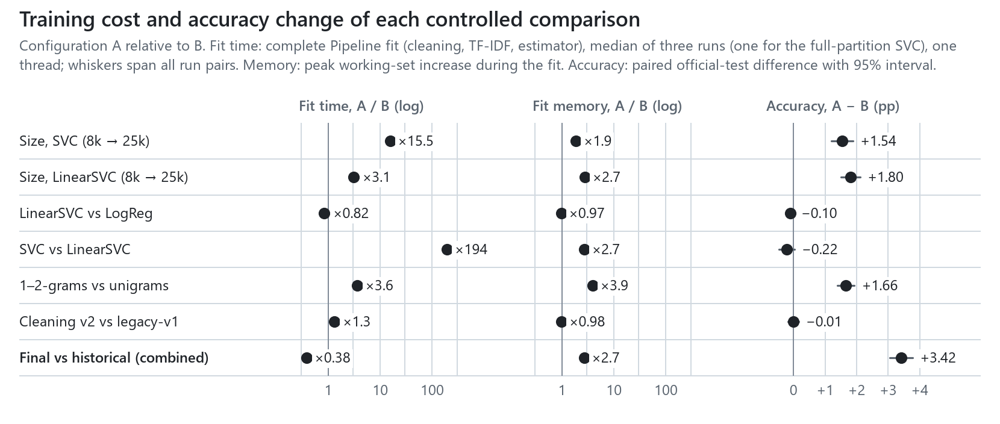
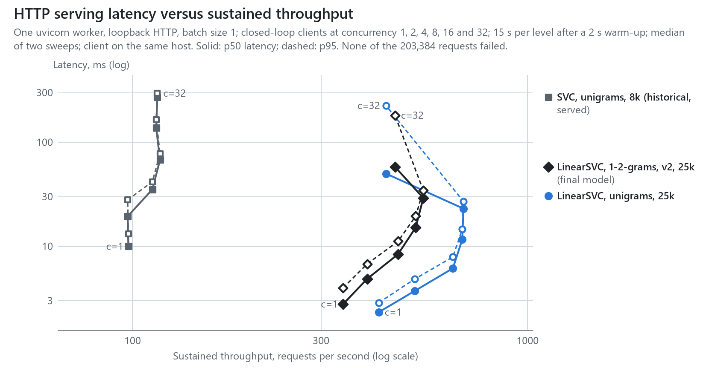

# Efficiency benchmarks

Training cost, model-only inference, HTTP serving and compute-cost estimates for the seven trained configurations
of the frozen study. The benchmark was added after the official test partition had been scored. It changes no
configuration, re-fits each one exactly as frozen in [`protocol_v1.json`](../protocol/protocol_v1.json), and reads
only official training-partition reviews; the official test partition enters only through the accuracy estimates of
the single scoring run. The Pareto analysis is post hoc. Tables between `<!-- table -->` markers are generated by
`study/report.py` from [`results/benchmarks/`](../results/benchmarks/); CI fails if they drift. The harness is
[`study/benchmark.py`](../study/benchmark.py); commands are in [`REPRODUCING.md`](REPRODUCING.md#efficiency-benchmarks).

## Environment and conditions

<!-- table:environment -->
| Item | Value |
|---|---|
| CPU | Intel(R) Core(TM) Ultra 7 165H: 16 cores, 22 logical CPUs; maximum clock reported by the operating system 3,800 MHz |
| Memory, operating system | 31.5 GB; Windows 11 |
| Software | CPython 3.15.2, NumPy 2.5.4, SciPy 1.18.1, scikit-learn 1.9.1, FastAPI 0.100.0, uvicorn 0.23.1 |
| HTTP stack | uvicorn 0.23.1, h11 0.16.0, fastapi 0.100.0, starlette 0.27.0, pydantic 2.14.3, anyio 4.16.0, httpx 0.27.2; not installed: httptools, uvloop |
| Threads | `OMP_NUM_THREADS=1`, `OPENBLAS_NUM_THREADS=1`, `MKL_NUM_THREADS=1` |
| Placement | Benchmark processes restricted to the 12 logical CPUs of the performance cores (0, 1, 10, 11, 12, 13, 14, 15, 16, 17, 18, 19) at above-normal priority |
| Logical CPUs busy with other processes, training runs | median 3.9 (range 2.9–5.5) |
| Logical CPUs busy with other processes, inference measurements | median 5.2 (range 4.5–6.8) |
| Logical CPUs busy with other processes, HTTP levels | median 5.4 (range 3.5–11.7) |
<!-- /table:environment -->

Every model computation is single-threaded: the numerical libraries are pinned to one thread, and liblinear and libsvm
are single-threaded regardless. The host is a shared workstation, and other processes, which were not stopped or
changed, kept between 2.9 and 11.7 logical CPUs busy (table above; measured from the host's CPU counters over each
measurement interval, minus the benchmark's own CPU time). To keep the scheduler from delaying the benchmark or moving
it to the slower efficiency cores, every benchmark process ran on the performance cores at above-normal priority.
Their second hardware threads were shared with other work, so absolute times are likely longer than on an idle
machine. Wall-clock times use `time.perf_counter`; CPU times use the operating system's process counters, which
advance in 15.6 ms ticks on Windows.

**Run history.** Each table comes from the last run of its stage. A first complete run stopped when one training
process exited with an access violation; it was discarded, and the harness gained the placement, the load recording
and a single retry for crashed processes. The inference stage then ran three times. Measuring one configuration after
another let drifting load masquerade as model differences: `logreg_uni_full` and `linsvc_uni_full`, which share their
cleaning, vocabulary and scoring code, differed in single-request p50 by 0.43 ms (0.77 against 1.20 ms). The stage was
therefore changed to measure in rounds over all configurations, and rerun once more to record every batch pass. The
HTTP stage was rerun after the other processes' load fell from 8–19 to about 5 busy logical CPUs, so that it ran under
conditions like the final inference run. The training stage was rerun last, because writing its results had rounded
integer feature counts to six significant digits (1,533,232 became 1,533,230); the rerun also put it under the same
lower load. The superseded results that were kept are in [`superseded/`](../results/benchmarks/superseded/): the first
attempt's training runs, the training runs and the HTTP sweep under higher load, and the sequential inference run; the
three-pass interleaved inference run was overwritten.

## Measurement boundaries

| Benchmark | Included | Excluded | Repetition |
|---|---|---|---|
| Training | `Pipeline.fit` on in-memory texts: cleaning, `TfidfVectorizer.fit_transform`, estimator fit. Peak memory is the process's peak working set; the fit increment subtracts the working set after the training texts were loaded. | Reading the dataset, serialising the artefact. | Each run in a fresh process: three per configuration, one for `svc_uni_full` (641 s in the reported run), with repeats interleaved across configurations. A process that crashes is retried once and the crash recorded. |
| Model-only inference | Artefact loading: SHA-256 check, `joblib` load and manifest validation, with a warm file cache. Requests: cleaning, TF-IDF transform and one `decision_function` call, in process. | HTTP, JSON, request validation. | Every configuration held in memory and measured in rounds over all configurations, in alternating order: five loads; after 200 warm-up requests each, three runs of 1,000 sequential single-review requests; five passes over the 2,000-review workload at batch sizes 64 and 1,024, each recorded in [`inference_passes.csv`](../results/benchmarks/inference_passes.csv). Batch figures are medians over passes. |
| HTTP serving | Client → loopback TCP → uvicorn (one worker process, h11 parser, asyncio event loop) → FastAPI validation → the same model path in the default thread pool → JSON response → client. Batch size 1. | Network beyond loopback, TLS, process start-up (reported separately as time to first successful `GET /model`). | A fresh server per sweep; 200 warm-up requests; closed-loop clients at concurrency 1, 2, 4, 8, 16 and 32, each level a 2 s warm-up and a 15 s measurement window; two sweeps. |

The workload is a fixed sample of 2,000 official training-partition reviews (seed 7;
[`workload_ids.csv`](../results/benchmarks/workload_ids.csv)). The HTTP client is an `httpx.AsyncClient` with
keep-alive connections on the same host; its CPU utilisation is recorded, and a value near 1.0 would mean the client
rather than the server limited throughput. Server CPU is sampled from the process that owns the listening socket at
the boundaries of each measurement window.

## Training

<!-- table:training -->
| Configuration | Training reviews | Features | Runs | Pipeline fit, s: median [range] | Cleaning / TF-IDF / estimator, s | Fit CPU, s | Peak working set, MB | Fit increment, MB | Max score difference vs frozen artefact | Other processes, busy CPUs |
|---|---:|---:|---:|---|---|---:|---:|---:|---:|---:|
| `svc_uni_8k_historical` | 8,000 | 59,770 | 3 | 41.2 [41.1–41.4] | 0.13 / 0.87 / 40.3 | 40.9 | 399 | 222 | 8.3e-04 | 3.7 |
| `svc_uni_full` | 25,000 | 108,635 | 1 | 641 | 0.43 / 2.8 / 638 | 637 | 618 | 415 | 0.0e+00 | 3.9 |
| `logreg_uni_full` | 25,000 | 108,635 | 3 | 4.00 [3.73–4.01] | 0.42 / 2.8 / 0.779 | 3.95 | 361 | 159 | 4.9e-08 | 3.7 |
| `linsvc_uni_full` | 25,000 | 108,635 | 3 | 3.30 [3.29–3.31] | 0.43 / 2.7 / 0.208 | 3.27 | 356 | 154 | 0.0e+00 | 4.3 |
| `linsvc_uni_8k` | 8,000 | 59,770 | 3 | 1.07 [1.01–1.14] | 0.15 / 0.86 / 0.0572 | 1.08 | 233 | 56 | 0.0e+00 | 3.8 |
| `linsvc_bi_full` | 25,000 | 1,594,660 | 3 | 12.0 [11.8–12.1] | 0.41 / 10 / 1.41 | 12.0 | 804 | 602 | 0.0e+00 | 3.8 |
| `linsvc_bi_v2_full` | 25,000 | 1,533,232 | 3 | 15.8 [15.7–16.1] | 4.6 / 10 / 0.974 | 15.7 | 795 | 593 | 0.0e+00 | 4.4 |
<!-- /table:training -->

Every re-fit reproduces its frozen artefact: decision scores on 500 training reviews agree exactly for five
configurations, to within 4.9e-08 for logistic regression, and to within 8.3e-04 for the historical SVC, whose
original was fitted by `train.py` in a different row order. Fitting the vectoriser takes 63–85% of every LinearSVC and
logistic-regression fit; cleaning v2 takes 4.60 s of the final model's fit, against 0.41–0.43 s for legacy-v1 on the
same 25,000 reviews. libsvm's optimisation takes at least 97% of every SVC fit. Every fit time lies within 7% of its
configuration's median; the 25,000-review SVC ran once.

## Controlled comparisons

Each row pairs two configurations that differ in one factor, except the last. Fit-time and memory ranges pair every
run of A with every run of B; accuracy differences are the paired official-test estimates with 95% block-bootstrap
intervals ([`RESULTS.md`](RESULTS.md#paired-comparisons)).

<!-- table:tradeoffs -->
| Comparison (A − B) | Factor | Δ accuracy, pp [95% CI] | Fit time, A / B [range] | Fit memory, A / B [range] | Inference CPU, A / B |
|---|---|---|---|---|---:|
| `svc_uni_full` − `svc_uni_8k_historical` | training-set size (SVC, C=1) | +1.54 [+1.20, +1.88] | 15.5× [15.5×–15.6×] | 1.9× [1.9×–1.9×] | 2.3× |
| `linsvc_uni_full` − `linsvc_uni_8k` | training-set size (LinearSVC, same C) | +1.80 [+1.51, +2.12] | 3.1× [2.9×–3.3×] | 2.7× [2.7×–2.8×] | 1.1× |
| `linsvc_uni_full` − `logreg_uni_full` | estimator (both C-tuned on development folds) | −0.10 [−0.21, +0.01] | 0.82× [0.82×–0.89×] | 0.97× [0.97×–0.97×] | 1.1× |
| `svc_uni_full` − `linsvc_uni_full` | estimator (SVC at the untuned historical C=1 vs C-tuned LinearSVC) | −0.22 [−0.46, +0.03] | 194× [194×–195×] | 2.7× [2.7×–2.7×] | 91.1× |
| `linsvc_bi_full` − `linsvc_uni_full` | word 1-2 grams vs unigrams | +1.66 [+1.39, +1.93] | 3.6× [3.6×–3.7×] | 3.9× [3.9×–3.9×] | 2.4× |
| `linsvc_bi_v2_full` − `linsvc_bi_full` | cleaning v2 vs legacy-v1 | −0.01 [−0.18, +0.16] | 1.3× [1.3×–1.4×] | 0.98× [0.98×–0.99×] | 1.5× |
| `linsvc_bi_v2_full` − `svc_uni_8k_historical` | combined: estimator, C, features, cleaning and training-set size together | +3.42 [+3.05, +3.78] | 0.38× [0.38×–0.39×] | 2.7× [2.7×–2.7×] | 0.093× |
<!-- /table:tradeoffs -->

<picture>
  <source media="(min-width: 960px) and (prefers-color-scheme: dark)" srcset="../visual_outputs/12_training_tradeoffs_dark.png">
  <source media="(max-width: 959px) and (prefers-color-scheme: dark)" srcset="../visual_outputs/12_training_tradeoffs_narrow_dark.png" width="360">
  <source media="(max-width: 959px)" srcset="../visual_outputs/12_training_tradeoffs_narrow_light.png" width="360">
  
</picture>

## Model-only inference

<!-- table:inference -->
| Configuration | Artefact, MB | Support vectors | Load, s | Single request p50 / p95 / p99, ms | Batch 64, predictions/s | Batch 1,024, predictions/s [range] | CPU s per 1,000: batch 64 / 1,024 [range at 1,024] |
|---|---:|---:|---:|---|---:|---|---|
| `svc_uni_8k_historical` | 8.9 | 4,727 | 0.08 | 7.41 / 10.41 / 11.71 | 187 | 187 [184–203] | 5.31 / 5.30 [4.88–5.38] |
| `svc_uni_full` | 20.5 | 11,160 | 0.16 | 16.65 / 23.21 / 25.54 | 81 | 82 [79–83] | 12.3 / 12.1 [11.9–12.5] |
| `logreg_uni_full` | 3.3 | — | 0.12 | 0.57 / 0.95 / 1.16 | 7,231 | 7,906 [7,400–8,568] | 0.141 / 0.125 [0.117–0.133] |
| `linsvc_uni_full` | 3.3 | — | 0.12 | 0.59 / 0.95 / 1.20 | 6,997 | 7,527 [7,154–8,349] | 0.141 / 0.133 [0.117–0.141] |
| `linsvc_uni_8k` | 1.7 | — | 0.06 | 0.55 / 0.93 / 1.14 | 6,862 | 7,955 [7,175–8,544] | 0.141 / 0.117 [0.117–0.141] |
| `linsvc_bi_full` | 55.3 | — | 2.02 | 0.71 / 1.38 / 1.82 | 3,018 | 3,110 [3,027–3,267] | 0.336 / 0.320 [0.305–0.336] |
| `linsvc_bi_v2_full` | 52.7 | — | 1.97 | 0.90 / 1.94 / 2.51 | 1,930 | 2,042 [1,899–2,135] | 0.508 / 0.492 [0.461–0.523] |
<!-- /table:inference -->

The two SVCs score each review against their 4,727 and 11,160 support vectors and need 5.30 and 12.1 CPU seconds per
1,000 predictions; the LinearSVC and logistic-regression configurations compute one sparse dot product per review and
need 0.117–0.492 s. Within the same rounds, the final model needed 1.48–1.60 times the CPU of `linsvc_bi_full` in each
of the five passes, `linsvc_bi_full` 2.35–2.80 times that of `linsvc_uni_full`, and the historical SVC 10.1–11.5 times
the final model's. The three unigram LinearSVC and logistic-regression configurations differ by one or two ticks of
the process clock per pass (0.008 s per 1,000 predictions each) and are not ranked. Batches of 64 cost at most 20%
more CPU per prediction than batches of 1,024, a difference within the clock's resolution for the unigram models.
Loading a bigram artefact takes about 2 s, against 0.06–0.16 s for the others, in line with the size of its
1.5-million-term vocabulary.

## HTTP serving

<!-- table:http -->
| Configuration | Concurrency | Throughput, requests/s [sweep range] | p50 / p95 / p99, ms | Failed / completed | Server CPU utilisation | Client CPU utilisation | Server CPU s per 1,000 requests |
|---|---:|---|---|---|---:|---:|---:|
| `svc_uni_8k_historical` | 1 | 98 [97–98] | 10.0 / 13.2 / 14.5 | 0 / 2,928 | 0.91 | 0.13 | 9.29 |
| `svc_uni_8k_historical` | 2 | 97 [90–105] | 19.5 / 28.0 / 31.5 | 0 / 2,915 | 0.96 | 0.12 | 9.91 |
| `svc_uni_8k_historical` | 4 | 112 [112–112] | 35.3 / 41.9 / 45.9 | 0 / 3,367 | 1.01 | 0.13 | 9.04 |
| `svc_uni_8k_historical` | 8 | 117 [117–118] | 68.0 / 78.1 / 83.2 | 0 / 3,520 | 1.02 | 0.12 | 8.70 |
| `svc_uni_8k_historical` | 16 | 115 [113–116] | 138.3 / 165.2 / 183.7 | 0 / 3,443 | 1.03 | 0.12 | 8.95 |
| `svc_uni_8k_historical` | 32 | 116 [113–118] | 272.5 / 296.8 / 311.3 | 0 / 3,465 | 1.04 | 0.14 | 9.04 |
| `linsvc_uni_full` | 1 | 420 [398–442] | 2.3 / 2.9 / 3.3 | 0 / 12,597 | 0.74 | 0.37 | 1.76 |
| `linsvc_uni_full` | 2 | 518 [500–536] | 3.7 / 4.9 / 5.9 | 0 / 15,535 | 0.92 | 0.44 | 1.77 |
| `linsvc_uni_full` | 4 | 647 [643–651] | 6.2 / 7.9 / 9.0 | 0 / 19,403 | 1.08 | 0.52 | 1.67 |
| `linsvc_uni_full` | 8 | 683 [652–715] | 11.7 / 14.6 / 17.0 | 0 / 20,499 | 1.13 | 0.59 | 1.65 |
| `linsvc_uni_full` | 16 | 688 [672–704] | 23.1 / 27.0 / 36.4 | 0 / 20,643 | 1.13 | 0.63 | 1.65 |
| `linsvc_uni_full` | 32 | 438 [401–475] | 50.1 / 225.8 / 359.8 | 0 / 13,141 | 0.83 | 0.91 | 1.90 |
| `linsvc_bi_v2_full` | 1 | 341 [339–344] | 2.8 / 4.0 / 4.7 | 0 / 10,235 | 0.78 | 0.33 | 2.29 |
| `linsvc_bi_v2_full` | 2 | 393 [380–405] | 4.9 / 6.8 / 8.4 | 0 / 11,777 | 0.94 | 0.34 | 2.40 |
| `linsvc_bi_v2_full` | 4 | 470 [469–471] | 8.4 / 11.2 / 13.1 | 0 / 14,101 | 1.12 | 0.42 | 2.39 |
| `linsvc_bi_v2_full` | 8 | 521 [513–528] | 15.2 / 19.6 / 22.4 | 0 / 15,628 | 1.13 | 0.46 | 2.16 |
| `linsvc_bi_v2_full` | 16 | 544 [540–549] | 29.2 / 34.5 / 38.8 | 0 / 16,332 | 1.13 | 0.48 | 2.08 |
| `linsvc_bi_v2_full` | 32 | 462 [454–470] | 58.1 / 181.9 / 328.2 | 0 / 13,855 | 1.02 | 0.78 | 2.21 |
<!-- /table:http -->

None of the 203,384 requests failed. From concurrency 4 to 16 every server kept 1.01–1.15 CPUs busy; utilisation
above 1 can only come from threads running outside the interpreter lock, such as socket I/O. A single worker's
throughput is therefore bounded by the inverse of its CPU time per request. Median throughput peaks at concurrency 16
for the linear models and at 8 for the historical SVC; beyond that, latency grows with the queue while throughput
does not. At concurrency 32 the client, a single asyncio process on the same host, used 0.87–0.95 of a CPU with
`linsvc_uni_full` and 0.77–0.78 with the final model, so those points are partly client-limited; at lower concurrency
it never exceeded 0.64. A fresh server took 3.3–5.5 s from process start to its first successful `GET /model`, at
default priority, including interpreter start-up, imports and artefact loading.

<picture>
  <source media="(min-width: 960px) and (prefers-color-scheme: dark)" srcset="../visual_outputs/13_serving_latency_dark.png">
  <source media="(max-width: 959px) and (prefers-color-scheme: dark)" srcset="../visual_outputs/13_serving_latency_narrow_dark.png" width="360">
  <source media="(max-width: 959px)" srcset="../visual_outputs/13_serving_latency_narrow_light.png" width="360">
  
</picture>

## Compute-cost estimates

No paid API was called, so no charge was observed. Local costs are estimates that combine measured CPU time with
hypothetical prices:

$$\text{USD per 1,000 predictions} = \frac{r \times t_{1000}}{3600 \times u},$$

where $t_{1000}$ is the measured CPU seconds per 1,000 predictions, $r$ the price of one vCPU-hour and $u$ the
average utilisation of the provisioned CPU. The grid covers $r \in \{0.02, 0.05, 0.10\}$ USD and
$u \in \{0.25, 0.50, 1.00\}$; the reference point is $r = 0.05$, $u = 0.50$. These prices are parameters, not quotes
from any provider, and exclude memory, storage, network and engineering costs. Batch costs use in-process CPU time at
batch size 1,024, which includes cleaning and TF-IDF transformation. Interactive costs use the server process's CPU
time per completed request at the concurrency level with the highest throughput; they include HTTP parsing,
validation and serialisation but not the client. The client issues no retries, and server CPU spent on a failed
request is charged to the completed ones. Every row of [`costs.csv`](../results/benchmarks/costs.csv) states its
status as an estimate.

<!-- table:economics -->
| Configuration | Mode | CPU s per 1,000 predictions (measured) | USD per million predictions, reference (estimate) | Range over rates and utilisations (estimate) |
|---|---|---:|---:|---|
| `svc_uni_8k_historical` | batch, in-process | 5.30 | 0.15 | 0.029–0.59 |
| `svc_uni_8k_historical` | interactive HTTP | 8.70 | 0.24 | 0.048–0.97 |
| `svc_uni_full` | batch, in-process | 12.1 | 0.34 | 0.067–1.3 |
| `logreg_uni_full` | batch, in-process | 0.125 | 0.0035 | 0.00069–0.014 |
| `linsvc_uni_full` | batch, in-process | 0.133 | 0.0037 | 0.00074–0.015 |
| `linsvc_uni_full` | interactive HTTP | 1.65 | 0.046 | 0.0092–0.18 |
| `linsvc_uni_8k` | batch, in-process | 0.117 | 0.0033 | 0.00065–0.013 |
| `linsvc_bi_full` | batch, in-process | 0.320 | 0.0089 | 0.0018–0.036 |
| `linsvc_bi_v2_full` | batch, in-process | 0.492 | 0.014 | 0.0027–0.055 |
| `linsvc_bi_v2_full` | interactive HTTP | 2.08 | 0.058 | 0.012–0.23 |
<!-- /table:economics -->

Rankings do not depend on the price or the utilisation: both scale every configuration's cost by the same factor.

The LLM baseline in [`study/llm/`](../study/llm/) has not been run, so no LLM accuracy, token count, charge or
latency exists in this repository, and no LLM appears in any comparison here.
