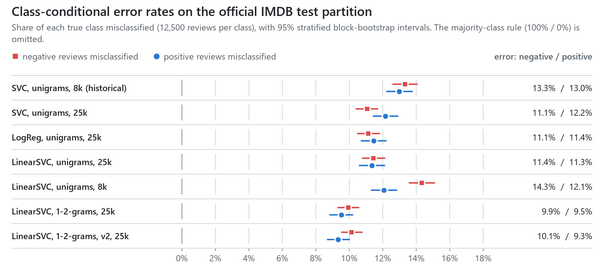
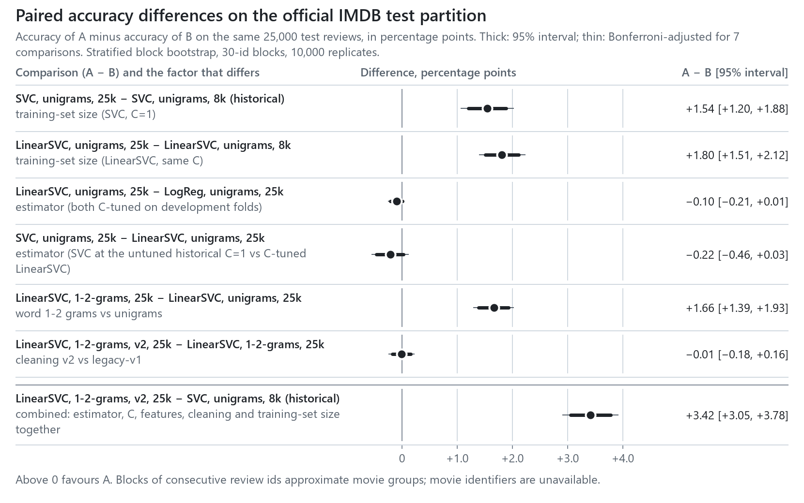
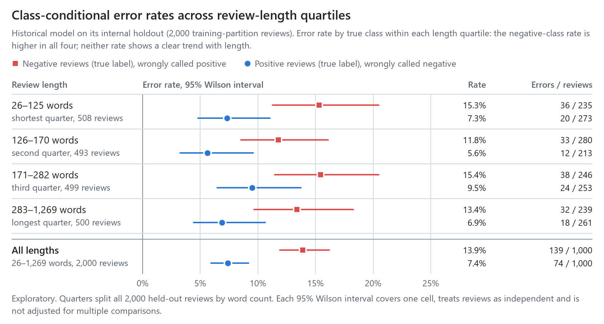
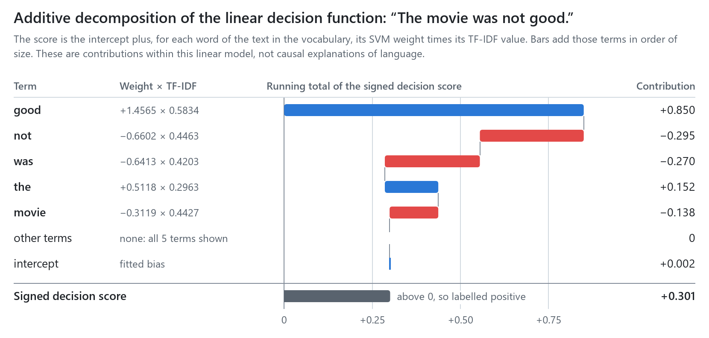
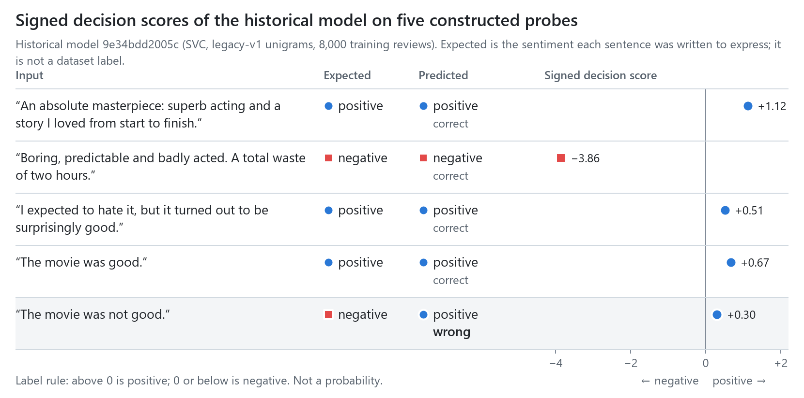

# Supplementary results

Complete predictive results of the frozen study: every candidate on the official test partition, the seven
pre-specified paired comparisons, sensitivity analyses, development-set selection, the behavioural suite and the
historical model's original evaluation. Tables between `<!-- table -->` markers are generated by `study/report.py`
from the files in [`results/`](../results/); CI fails if they drift. Efficiency measurements are in
[`BENCHMARKS.md`](BENCHMARKS.md).

Development (cross-validation on the official training partition), official-test and behavioural-suite results
are reported separately throughout. The official test partition was scored once, after the protocol freeze.

## Method

Each candidate maps a review $x$ to a signed decision score

$$f(x) = \mathbf{w}^\top \phi(x) + b,$$

where $\phi(x)$ is the L2-normalised TF-IDF vector of the cleaned text. The label is $\hat y = \mathbb{1}[f(x) > 0]$;
an exact zero is negative. For the linear-kernel SVC, $\mathbf{w} = \sum_i \alpha_i y_i \phi(x_i)$ over the support
vectors, so every candidate's score is linear in $\phi(x)$ and decomposes exactly into per-term contributions
$w_j \phi_j(x)$ plus $b$ (figure 08).

For predictions on the $n_c$ test reviews of true class $c$, the class-conditional error rate is

$$e_c = \frac{1}{n_c} \sum_{i:\, y_i = c} \mathbb{1}[\hat y_i \neq c].$$

For a paired comparison of candidates A and B on the same reviews, the estimand is
$\Delta = \mathrm{acc}_A - \mathrm{acc}_B$. Each bootstrap replicate $b$ draws, within each label, as many 30-id
blocks as that label has, with replacement, and evaluates both candidates on the same multiset of reviews, giving
$\Delta^{*}_b$; the 95% interval is the 2.5th to 97.5th percentile of $\{\Delta^{*}_b\}_{b=1}^{10\,000}$.

Movie identifiers are not available from any reachable source: the archive mirror omits the `urls_*.txt` files, and
the canonical host did not respond. Review ids are, however, ordered by movie within each directory. The mean TF-IDF
cosine between reviews with adjacent ids is 0.092–0.129, against 0.035–0.038 for random pairs, and it decays to the
random level by a lag of 20–30 ids (`results/data/duplicate_audit.json`). Blocks of 30 consecutive ids, the
dataset's cap on reviews per movie, therefore approximate movie clusters; a movie that straddles a block boundary is
split across two blocks, so some dependence remains. The two partitions contain disjoint sets of movies, as the
dataset's README states.

## Official test partition

All rows score the same 25,000 official test reviews (12,500 per class). Intervals are 95% stratified
block-bootstrap percentile intervals. Data: [`metrics.csv`](../results/official_test/metrics.csv); per-review scores
and labels: [`predictions.csv.gz`](../results/official_test/predictions.csv.gz).

<!-- table:results -->
| Candidate | Estimator | Features, cleaning | C | Training reviews | Accuracy % [95% CI] | Macro F1 % [95% CI] | Error, negative class % | Error, positive class % |
|---|---|---|---:|---:|---|---|---|---|
| `majority` | constant | — | — | 25,000 | 50.00 [49.94–50.06] | 33.33 [33.31–33.36] | 0.00 [0.00–0.00] | 100.00 [100.00–100.00] |
| `svc_uni_8k_historical` | SVC (linear kernel) | unigrams, legacy-v1 | 1 | 8,000 | 86.85 [86.32–87.37] | 86.85 [86.32–87.37] | 13.32 [12.60–14.04] | 12.98 [12.23–13.75] |
| `svc_uni_full` | SVC (linear kernel) | unigrams, legacy-v1 | 1 | 25,000 | 88.39 [87.90–88.88] | 88.39 [87.90–88.88] | 11.06 [10.42–11.70] | 12.16 [11.44–12.90] |
| `logreg_uni_full` | LogisticRegression | unigrams, legacy-v1 | 2 | 25,000 | 88.71 [88.21–89.20] | 88.71 [88.21–89.20] | 11.14 [10.50–11.80] | 11.45 [10.72–12.19] |
| `linsvc_uni_full` | LinearSVC | unigrams, legacy-v1 | 0.125 | 25,000 | 88.61 [88.11–89.10] | 88.61 [88.11–89.10] | 11.44 [10.79–12.11] | 11.34 [10.61–12.11] |
| `linsvc_uni_8k` | LinearSVC | unigrams, legacy-v1 | 0.125 | 8,000 | 86.80 [86.26–87.33] | 86.80 [86.25–87.33] | 14.33 [13.59–15.10] | 12.06 [11.32–12.83] |
| `linsvc_bi_full` | LinearSVC | 1–2-grams, legacy-v1 | 1 | 25,000 | 90.27 [89.80–90.72] | 90.27 [89.80–90.72] | 9.94 [9.34–10.57] | 9.52 [8.85–10.20] |
| `linsvc_bi_v2_full` | LinearSVC | 1–2-grams, v2 | 0.5 | 25,000 | 90.26 [89.80–90.70] | 90.26 [89.80–90.70] | 10.14 [9.54–10.75] | 9.34 [8.70–9.99] |
<!-- /table:results -->

The historical model scores 86.85% on the official test partition, against 89.35% (87.92–90.63%, Wilson) on the
internal holdout of its original protocol. That holdout drew both its training and evaluation reviews from one
10,000-review sample of the training partition without movie-level separation. The 6.5-point class asymmetry it
measured (13.9% negative-class against 7.4% positive-class error) is not reproduced on the official test partition
(13.32% against 12.98%).

<picture>
  <source media="(min-width: 960px) and (prefers-color-scheme: dark)" srcset="../visual_outputs/10_class_error_rates_dark.png">
  <source media="(max-width: 959px) and (prefers-color-scheme: dark)" srcset="../visual_outputs/10_class_error_rates_narrow_dark.png" width="360">
  <source media="(max-width: 959px)" srcset="../visual_outputs/10_class_error_rates_narrow_light.png" width="360">
  
</picture>

Asymmetry between the two class-conditional error rates depends on the model rather than being a stable property
of the task. In an exploratory, post hoc analysis
([`exploratory_class_asymmetry.csv`](../results/official_test/exploratory_class_asymmetry.csv)),
$e_{\text{neg}} - e_{\text{pos}}$ is +0.34 points, −0.72 to +1.38, for the historical model, +2.26 points (+1.21 to
+3.34) for LinearSVC trained on the historical 8,000 reviews, −1.10 (−2.08 to −0.14) for the SVC trained on all
25,000, and indistinguishable from zero for the other trained candidates.

Errors concentrate near the rating boundary. For the final model, 21.4% of reviews rated 4 and 18.9% of those rated
7 are misclassified, against 4.7% at rating 1 and 6.0% at rating 10 (pre-specified rating slices;
[`slices.csv`](../results/official_test/slices.csv)).

## Paired comparisons

Each row compares two candidates that differ in the named factor only, except the last, which combines all factors
and is attributable to none of them alone. Positive values favour A. Bonferroni intervals adjust for the seven
pre-specified comparisons. Data: [`paired_differences.csv`](../results/official_test/paired_differences.csv), which
also holds macro F1 and class-conditional differences.

<!-- table:paired -->
| Comparison (A − B) | Factor | Δ accuracy, pp | 95% CI, 30-id blocks | Bonferroni CI (7) | 95% CI, example-level | 95% CI, 60-id blocks |
|---|---|---:|---|---|---|---|
| `svc_uni_full` − `svc_uni_8k_historical` | training-set size (SVC, C=1) | +1.54 | [+1.20, +1.88] | [+1.06, +2.03] | [+1.22, +1.87] | [+1.19, +1.89] |
| `linsvc_uni_full` − `linsvc_uni_8k` | training-set size (LinearSVC, same C) | +1.80 | [+1.51, +2.12] | [+1.39, +2.24] | [+1.53, +2.10] | [+1.51, +2.11] |
| `linsvc_uni_full` − `logreg_uni_full` | estimator (both C-tuned on development folds) | −0.10 | [−0.21, +0.01] | [−0.25, +0.04] | [−0.21, +0.01] | [−0.20, +0.00] |
| `svc_uni_full` − `linsvc_uni_full` | estimator (SVC at the untuned historical C=1 vs C-tuned LinearSVC) | −0.22 | [−0.46, +0.03] | [−0.56, +0.12] | [−0.46, +0.02] | [−0.46, +0.03] |
| `linsvc_bi_full` − `linsvc_uni_full` | word 1-2 grams vs unigrams | +1.66 | [+1.39, +1.93] | [+1.29, +2.03] | [+1.40, +1.94] | [+1.39, +1.95] |
| `linsvc_bi_v2_full` − `linsvc_bi_full` | cleaning v2 vs legacy-v1 | −0.01 | [−0.18, +0.16] | [−0.24, +0.22] | [−0.17, +0.16] | [−0.18, +0.17] |
| `linsvc_bi_v2_full` − `svc_uni_8k_historical` | combined: estimator, C, features, cleaning and training-set size together | +3.42 | [+3.05, +3.78] | [+2.91, +3.92] | [+3.08, +3.76] | [+3.05, +3.79] |
<!-- /table:paired -->

<picture>
  <source media="(min-width: 960px) and (prefers-color-scheme: dark)" srcset="../visual_outputs/09_paired_differences_dark.png">
  <source media="(max-width: 959px) and (prefers-color-scheme: dark)" srcset="../visual_outputs/09_paired_differences_narrow_dark.png" width="360">
  <source media="(max-width: 959px)" srcset="../visual_outputs/09_paired_differences_narrow_light.png" width="360">
  
</picture>

The two size effects, the bigram effect and the combined difference exclude zero under Bonferroni adjustment.
Cleaning v2 changes accuracy by −0.01 points although it led legacy-v1 by 0.22 points on development folds. The
resampling unit hardly changes the intervals: example-level, 30-id and 60-id intervals agree to within 0.03 points at
either end. Either the 30-id blocks capture little of the remaining dependence, or paired differences are
insensitive to it; the data cannot distinguish the two.

## Sensitivity to train–test overlap

123 test reviews occur verbatim in the training partition, and one more exceeds a TF-IDF cosine of 0.9 to a training
review. Removing these 124 changes no accuracy by more than 0.13 points (the majority-class rule) and no trained
candidate's by more than 0.05. Every paired difference keeps its sign and moves by at most 0.04 points
([`overlap_sensitivity.csv`](../results/official_test/overlap_sensitivity.csv)).

<!-- table:overlap -->
| Candidate | Accuracy %, all 25,000 | Accuracy %, 24,876 without overlap | Difference, pp |
|---|---:|---:|---:|
| `majority` | 50.00 | 49.87 | −0.13 |
| `svc_uni_8k_historical` | 86.85 | 86.83 | −0.01 |
| `svc_uni_full` | 88.39 | 88.35 | −0.04 |
| `logreg_uni_full` | 88.71 | 88.69 | −0.02 |
| `linsvc_uni_full` | 88.61 | 88.59 | −0.02 |
| `linsvc_uni_8k` | 86.80 | 86.81 | +0.01 |
| `linsvc_bi_full` | 90.27 | 90.22 | −0.05 |
| `linsvc_bi_v2_full` | 90.26 | 90.22 | −0.05 |
<!-- /table:overlap -->

## Development-set selection

Selection used the official training partition only: five folds of 100-id blocks per label, the vectoriser refitted
inside each training fold, C chosen by the highest mean validation accuracy with ties to the smaller C. LinearSVC
became the branch estimator for the feature and cleaning comparisons because its unigram development accuracy exceeded
logistic regression's, and the frozen protocol named `linsvc_bi_v2_full` the final model, by the highest development
accuracy among the C-tuned candidates, before any test score existed. Data: [`results/dev/`](../results/dev/).

<!-- table:development -->
| Estimator | Features, cleaning | Selected C | Mean CV accuracy % (SD across 5 folds) |
|---|---|---:|---|
| LinearSVC | unigrams, legacy-v1 | 0.125 | 86.91 (1.00) |
| LinearSVC | 1–2-grams, legacy-v1 | 1 | 88.18 (1.04) |
| LinearSVC | 1–2-grams, v2 | 0.5 | 88.39 (1.14) |
| LogisticRegression | unigrams, legacy-v1 | 2 | 86.87 (1.09) |
| LogisticRegression | 1–2-grams, legacy-v1 | 32 (grid edge) | 88.22 (1.07) |
| LogisticRegression | 1–2-grams, v2 | 32 (grid edge) | 88.38 (1.10) |
| SVC (linear kernel), reference only | unigrams, legacy-v1 | 1 (not tuned) | 86.07 (1.05) |
<!-- /table:development -->

Logistic regression's selected C lies at the upper edge of its grid for 1–2-gram features; no frozen candidate uses
those settings. The linear-kernel SVC was not tuned: one fit on 20,000 reviews took about 19 minutes on this machine.

The ablation removes one component of cleaning v2 at a time (development folds only). No component moves mean
accuracy by more than 0.06 points, which is small against the fold-to-fold standard deviation of about 1.1 points.

<!-- table:ablation -->
| Cleaning (1–2-grams, branch estimator at its selected C) | Mean CV accuracy % | Δ vs full v2, pp |
|---|---:|---:|
| v2 | 88.39 | — |
| v2-no-contractions | 88.37 | −0.02 |
| v2-no-digits | 88.36 | −0.04 |
| v2-no-fold | 88.42 | +0.02 |
| v2-no-html | 88.33 | −0.06 |
| v2-no-space | 88.34 | −0.06 |
<!-- /table:ablation -->

## Behavioural suite (provisional: labels not adjudicated)

The suite holds 237 constructed sentences in minimal pairs, label-preserving sets and single cases
([`behavioural/`](../behavioural/)). An AI assistant proposed every label, and no person has reviewed them; the
results do not estimate error rates on natural reviews. Template groups are assigned whole to development or
held-out families; the table reports the held-out families. A unit (pair, set or single case) fails if any member is
mislabelled. Each cell gives the failure rate in percent, failed/total units, and a 95% family-level bootstrap
interval. Data: [`failure_rates.csv`](../results/behavioural/failure_rates.csv); adjudication queue:
[`annotation_queue_v1.csv`](../behavioural/annotation_queue_v1.csv).

<!-- table:behavioural -->
| Candidate | Negation (37 units, 13 families) | Contrast (8 units, 5 families) | Sarcasm (10 units, 4 families) | Intensity (7 units, 7 families) |
|---|---|---|---|---|
| `majority` | 100 (37/37) [100–100] | 100 (8/8) [100–100] | 60 (6/10) [14–100] | 29 (2/7) [0–57] |
| `svc_uni_8k_historical` | 89 (33/37) [74–100] | 75 (6/8) [40–100] | 40 (4/10) [0–75] | 0 (0/7) [0–0] |
| `svc_uni_full` | 89 (33/37) [74–100] | 88 (7/8) [50–100] | 70 (7/10) [50–88] | 0 (0/7) [0–0] |
| `logreg_uni_full` | 86 (32/37) [70–100] | 88 (7/8) [50–100] | 80 (8/10) [62–100] | 0 (0/7) [0–0] |
| `linsvc_uni_full` | 86 (32/37) [70–100] | 88 (7/8) [50–100] | 80 (8/10) [62–100] | 0 (0/7) [0–0] |
| `linsvc_uni_8k` | 89 (33/37) [74–100] | 88 (7/8) [50–100] | 80 (8/10) [50–100] | 0 (0/7) [0–0] |
| `linsvc_bi_full` | 81 (30/37) [62–97] | 88 (7/8) [50–100] | 70 (7/10) [50–88] | 0 (0/7) [0–0] |
| `linsvc_bi_v2_full` | 84 (31/37) [67–97] | 88 (7/8) [50–100] | 60 (6/10) [0–100] | 0 (0/7) [0–0] |
<!-- /table:behavioural -->

On the held-out families, every trained candidate fails 81–89% of negation units and 75–88% of contrast units, and
none fails an intensity unit. Sarcasm failure ranges from 40% to 80% over only 10 units in 4 families, too few to
rank candidates. The majority-class rule fails every unit that has a positive member, which gives a reference level
for each phenomenon.

**Architectural property, not a measurement.** The development family `con-but` pairs sentences that are word
permutations of each other ("The acting was great, but overall the film was dull." / "The acting was dull, but
overall the film was great."). Under both cleaning versions the two members have identical token multisets, hence
identical unigram TF-IDF vectors and identical scores, so every unigram candidate fails such pairs by construction.
Word bigrams make the members distinguishable but do not guarantee the correct order of evidence.

## Historical results (internal holdout, protocol of 2026-11-06)

These results predate the study and keep their original protocol. The historical model (`svc_uni_8k_historical`)
was fitted on 8,000 reviews and evaluated on 2,000 held-out reviews, both drawn from a 10,000-review sample of the
official training partition by a stratified 80/20 split (seed 42). That split does not enforce movie-level
separation, so its estimates characterise the internal partition only. Its intervals are 95% Wilson intervals, which
treat reviews as independent.

On that holdout the model's accuracy is 89.35% (87.92–90.63%) and its macro F1 89.34%. Its class-conditional error
rates are 13.9% for negative reviews (139/1,000; 11.9–16.2%) and 7.4% for positive reviews (74/1,000; 5.9–9.2%). The
original metrics are archived unchanged in [`metrics.json`](../results/historical/metrics.json), and
[`refit_equivalence.json`](../results/historical/refit_equivalence.json) shows that the Pipeline re-fit equals the
original artefact parameter for parameter. Figures 06–08 come from `scripts/make_readme_figures.py`; their data are in
`visual_outputs/06–08_*.csv`, and the [historical run report](../visual_outputs/REPORT.md) gives details.

<picture>
  <source media="(min-width: 960px) and (prefers-color-scheme: dark)" srcset="../visual_outputs/07_error_by_length_dark.png">
  <source media="(max-width: 959px) and (prefers-color-scheme: dark)" srcset="../visual_outputs/07_error_by_length_narrow_dark.png" width="360">
  <source media="(max-width: 959px)" srcset="../visual_outputs/07_error_by_length_narrow_light.png" width="360">
  
</picture>

<picture>
  <source media="(min-width: 960px) and (prefers-color-scheme: dark)" srcset="../visual_outputs/08_score_contributions_dark.png">
  <source media="(max-width: 959px) and (prefers-color-scheme: dark)" srcset="../visual_outputs/08_score_contributions_narrow_dark.png" width="360">
  <source media="(max-width: 959px)" srcset="../visual_outputs/08_score_contributions_narrow_light.png" width="360">
  
</picture>

The decomposition shows why the historical model labels "The movie was not good." positive. Its score, +0.301, is a
sum in which the unigram *not* contributes −0.295 while *good* contributes +0.850. A unigram model assigns *not* one
weight regardless of the word it negates, so it cannot represent the scope of negation. Figure 06 shows the five
constructed probes behind this example; the behavioural suite measures the same construction systematically.

<picture>
  <source media="(min-width: 960px) and (prefers-color-scheme: dark)" srcset="../visual_outputs/06_probe_outputs_dark.png">
  <source media="(max-width: 959px) and (prefers-color-scheme: dark)" srcset="../visual_outputs/06_probe_outputs_narrow_dark.png" width="360">
  <source media="(max-width: 959px)" srcset="../visual_outputs/06_probe_outputs_narrow_light.png" width="360">
  
</picture>

## Timing recorded during the scoring run

[`results/official_test/inference.csv`](../results/official_test/inference.csv) holds batch and single-request
timings taken on the test reviews during the single scoring run, without thread pinning or repeats, and
[`results/study/fits/`](../results/study/fits/) records each frozen candidate's original fit time. Both are kept
unchanged as part of the scoring record. The efficiency results reported in the README and in
[`BENCHMARKS.md`](BENCHMARKS.md) come from the controlled benchmark instead.
