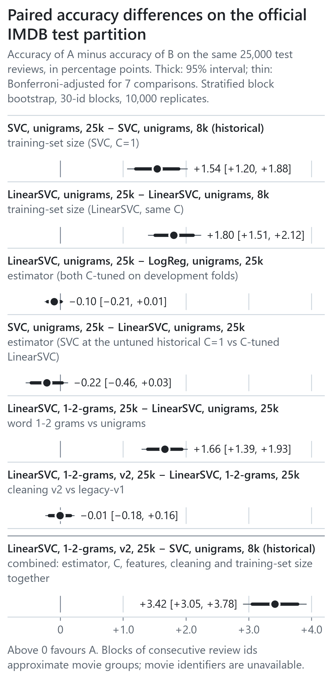
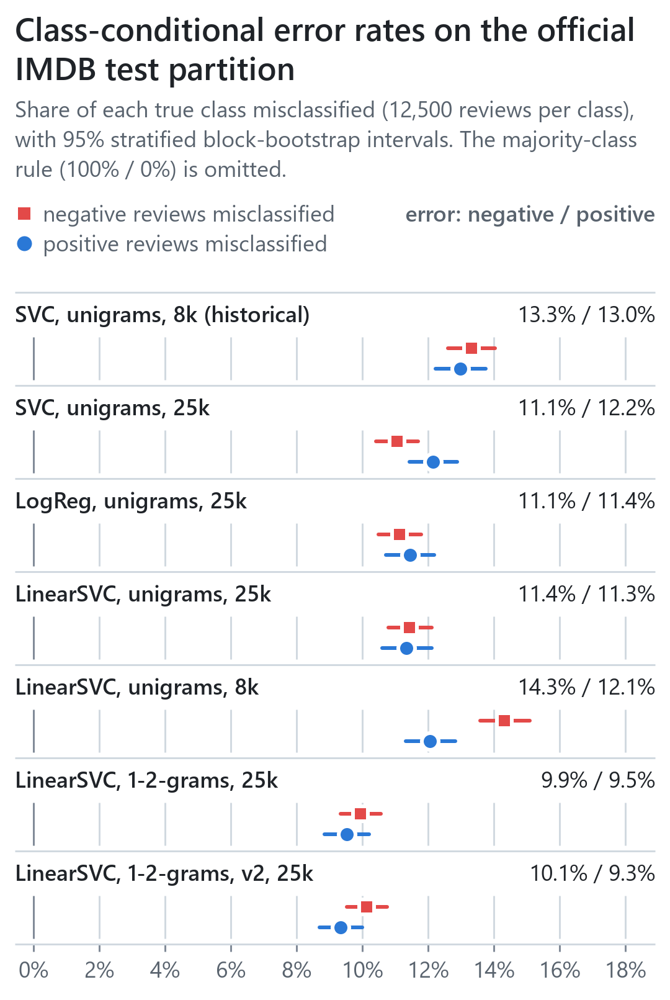
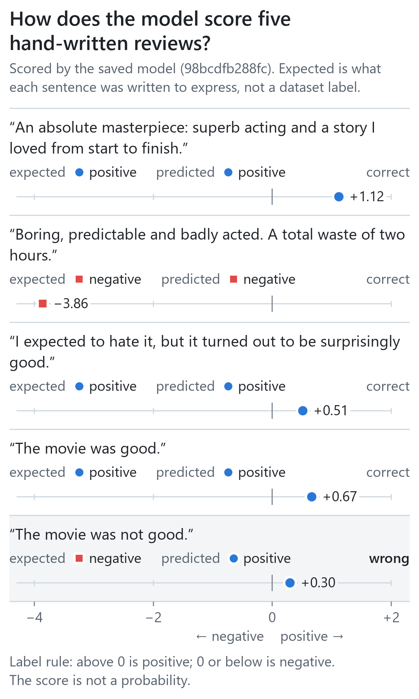
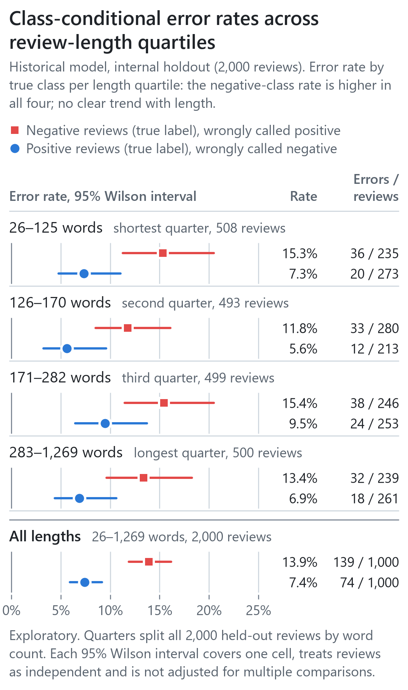
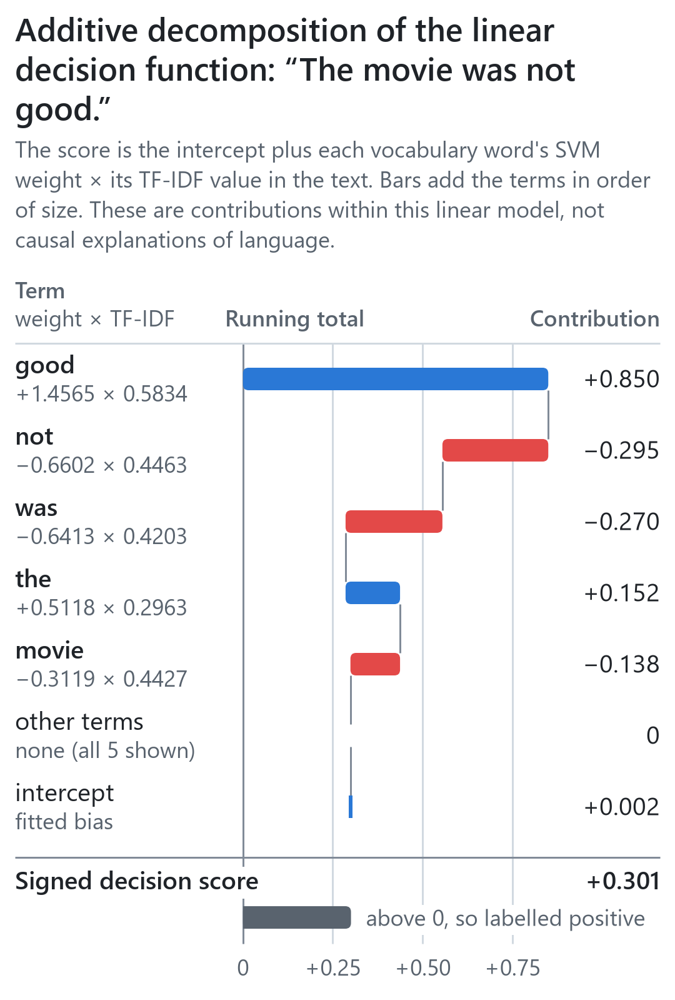

# Narrow-layout figures

Every figure in the [README](../README.md) is also drawn 360 CSS px wide for phone-width columns. The README
selects these layouts automatically below a 960 px viewport through `<picture>` media queries. GitHub's
`<themed-picture>` element, however, rewrites any `<source>` whose media query names a colour scheme when a
signed-in user has fixed the GitHub theme to light or dark rather than following the system setting; the
rewrite discards width conditions. The README therefore orders its sources so that such a rewrite can only
fall back to the wide figure, never place a narrow figure on a desktop. With a fixed dark theme, a phone
consequently receives the wide figure.

This page is the fallback: it shows each narrow figure as a plain image (light background, 360 CSS px wide), which renders the
same way for every theme setting and in the GitHub mobile app. Figures are generated by
`scripts/make_readme_figures.py` (06–08) and `study/figures.py` (09–10) from the CSV files named in each caption.

## Official test partition

Paired accuracy differences (A − B) on the 25,000 official test reviews. Data: `results/official_test/paired_differences.csv`.

Class-conditional error rates per candidate. Data: `results/official_test/metrics.csv`.

## Historical model (internal holdout, 2026-11-06 protocol)

Five constructed probes scored by the historical model. Data: `visual_outputs/06_probe_outputs.csv`.

Historical internal holdout, error rate by true class and length quartile. Data: `visual_outputs/07_error_by_length.csv`.

Additive decomposition of one decision score. Data: `visual_outputs/08_score_contributions.csv`.
