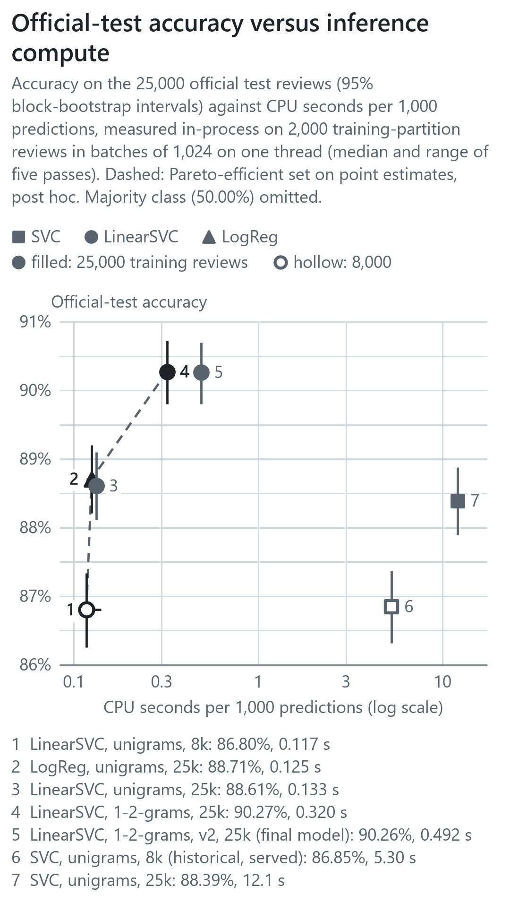
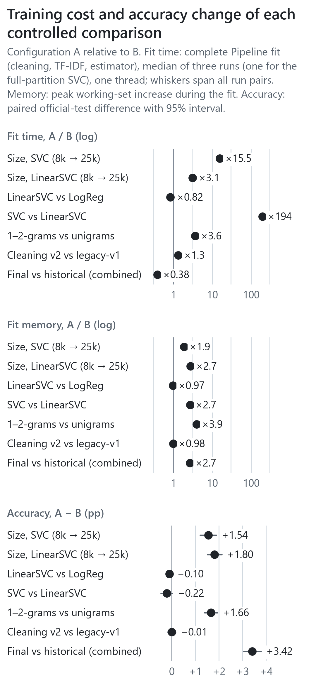
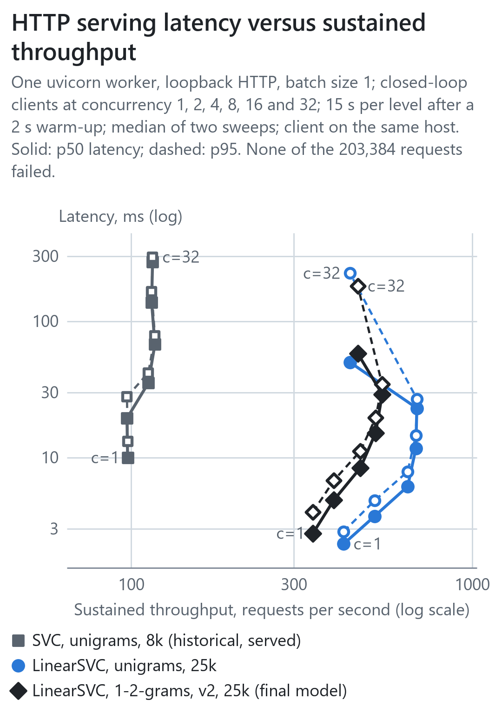

# Narrow-layout figures

Every figure in the [README](../README.md), the [supplementary results](RESULTS.md) and the
[benchmark report](BENCHMARKS.md) is also drawn 360 CSS px wide for phone-width columns. Those pages select these
layouts automatically below a 960 px viewport through `<picture>` media queries. GitHub's `<themed-picture>`
element, however, rewrites any `<source>` whose media query names a colour scheme when a signed-in user has fixed the
GitHub theme to light or dark rather than following the system setting; the rewrite discards width conditions. The
pages therefore order their sources so that such a rewrite can only fall back to the wide figure, never place a
narrow figure on a desktop. With a fixed dark theme, a phone consequently receives the wide figure.

This page is the fallback: it shows each narrow figure as a plain image (light background, 360 CSS px wide), which
renders the same way for every theme setting and in the GitHub mobile app. Figures are generated by
`scripts/make_readme_figures.py` (06–08), `study/figures.py` (09–10) and `study/efficiency_figures.py` (11–13) from
the files named in each caption.

## Efficiency

Official-test accuracy against batch inference CPU time. Data: `results/official_test/metrics.csv`,
`results/benchmarks/inference.csv`.

Training cost and accuracy change per controlled comparison. Data: `results/benchmarks/training_runs.csv`,
`results/official_test/paired_differences.csv`.

HTTP latency against throughput over the concurrency sweep. Data: `results/benchmarks/http.csv`.

## Official test partition

Paired accuracy differences (A − B) on the 25,000 official test reviews. Data:
`results/official_test/paired_differences.csv`.

Class-conditional error rates per candidate. Data: `results/official_test/metrics.csv`.

## Historical model (internal holdout, 2026-11-06 protocol)

Five constructed probes scored by the historical model. Data: `visual_outputs/06_probe_outputs.csv`.

Historical internal holdout, error rate by true class and length quartile. Data:
`visual_outputs/07_error_by_length.csv`.

Additive decomposition of one decision score. Data: `visual_outputs/08_score_contributions.csv`.
