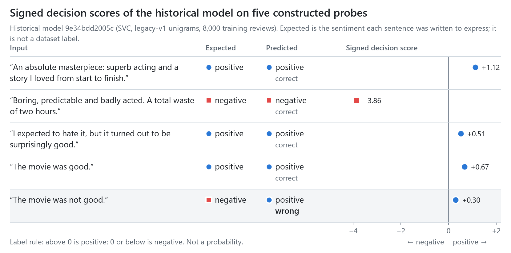
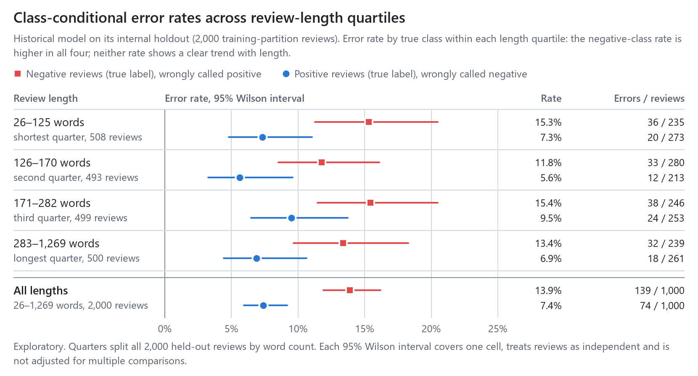
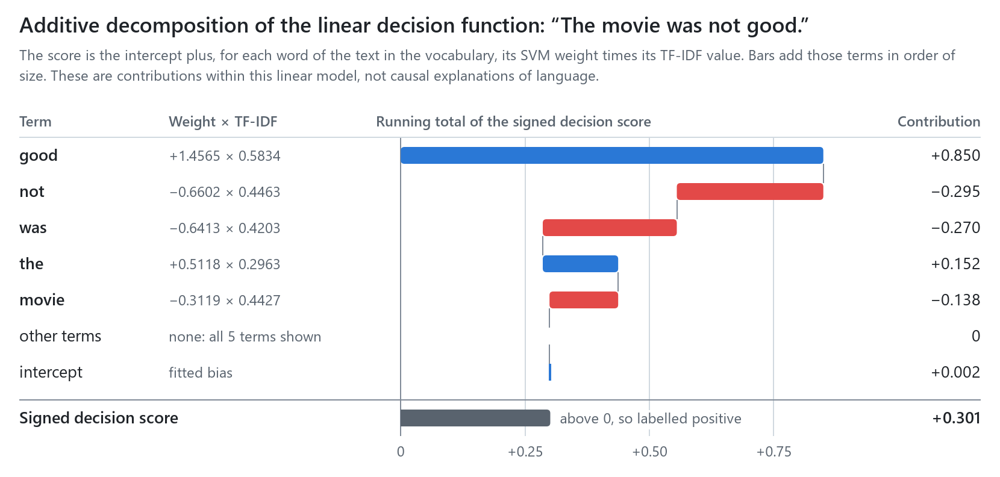
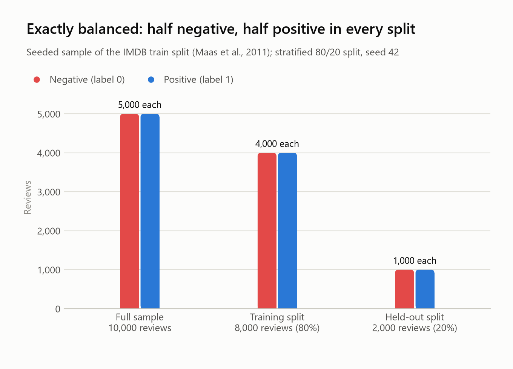
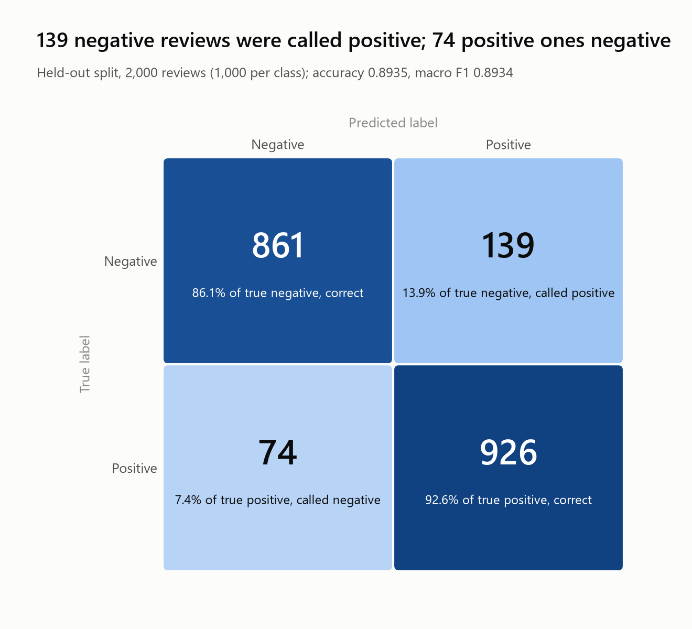
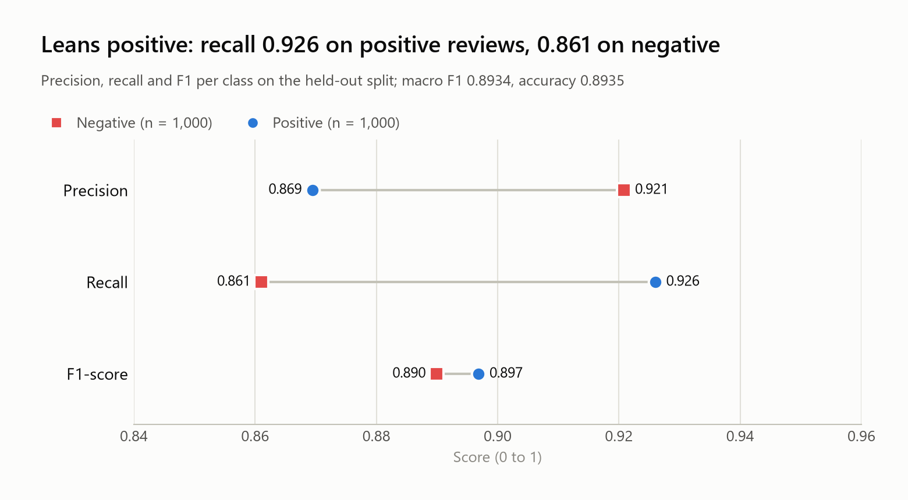
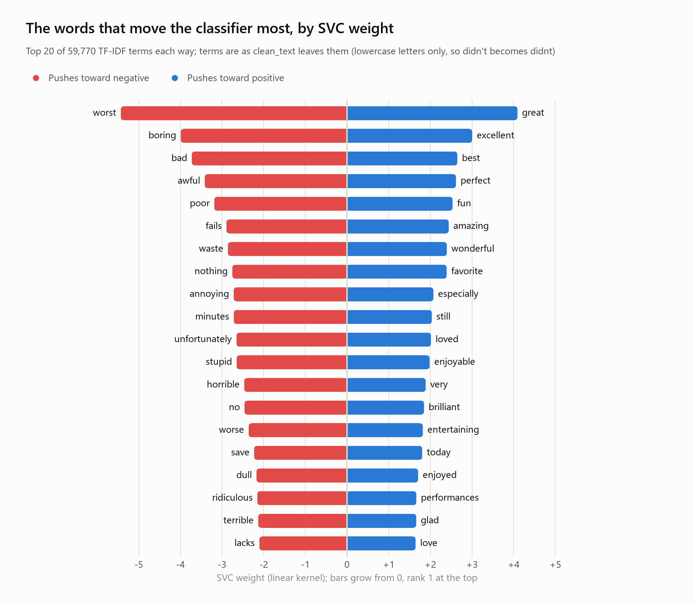
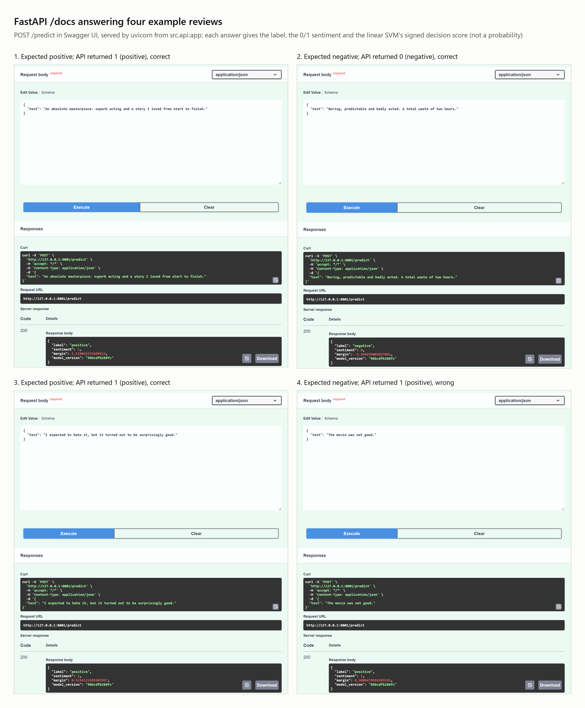

# Historical model: run report (internal-holdout protocol)

This report documents the historical model, its end-to-end run of 2026-11-06 under the original internal-holdout protocol (CPython 3.15.2), and the analysis behind figures 06–08. Its numbers describe a split inside the official training partition, not the official test partition; the comparative study on the official test partition is reported in the [README](../README.md) and in the [supplementary results](../docs/RESULTS.md). The original metrics file is archived unchanged in [`results/historical/metrics.json`](../results/historical/metrics.json).

## Result on the held-out split (2,000 reviews, 1,000 per class)

| | Precision | Recall | F1 |
|---|---|---|---|
| Negative | 0.9209 | 0.8610 | 0.8899 |
| Positive | 0.8695 | 0.9260 | 0.8969 |
| **Overall** | accuracy **0.8935** (95% CI 0.8792–0.9063) | | macro F1 **0.8934** |

The model leans positive: 139 of 1,000 negative reviews were predicted positive (13.9%, 95% CI 11.9–16.2%), against 74 of 1,000 positive reviews predicted negative (7.4%, 5.9–9.2%).

The held-out reviews are a stratified random 20% (seed 42) of a 10,000-review sample of IMDB's train split, so reviews of the same movie can sit on both sides, and these numbers are likely optimistic. All intervals here are 95% Wilson score intervals. They treat reviews as independent and take this fitted model and split as fixed, so they cover the sampling of held-out reviews only and do not correct for the same-movie overlap.

## Tooling

- The 10,000-review sample behind the internal split is built by `scripts/build_dataset.py` from a pinned Hugging Face revision of the dataset; it drops duplicate reviews and stops on a checksum mismatch.
- `python train.py` fits one scikit-learn `Pipeline` (cleaning version `legacy-v1`, then `TfidfVectorizer()`, then `SVC(kernel="linear")`) on the 8,000-review training split only (67 s in the original run; 4,727 support vectors, 59,770 terms), evaluates on the held-out 20%, and publishes the Pipeline with a manifest under `models/artefacts/<model_version>/`, pointed to by `models/serving.json`. Re-fitting through this path reproduces the original two-file artefact parameter for parameter ([`refit_equivalence.json`](../results/historical/refit_equivalence.json)); the artefact identifier changed from `98bcdfb288fc` to `9e34bdd2005c` because the serialisation changed.
- The label is derived from the signed decision score: above 0 is positive, 0 or below is negative. scikit-learn's `SVC.predict` follows libsvm's convention for an exact tie, which need not match this policy; adopting the policy changed none of the 2,000 held-out predictions.
- `python -m uvicorn src.api:app` loads the published Pipeline at startup and refuses to start if its manifest, SHA-256, schema version, classes, feature dimension or scikit-learn version do not match. `GET /model` reports the served artefact's identity.
  - `POST /predict` returns `label`, `sentiment`, `margin` (the linear SVM's signed decision score at full precision, not a probability) and `model_version`. The label comes from that same score: above 0 is positive, 0 or below is negative.
  - Invalid input gets a 422 with the reason. That includes text with no word from the model's vocabulary (a single letter, or only unseen words). An unexpected error gets a 500 without internal details.
- `python scripts/make_readme_figures.py` re-derives figures 06–08 from the published Pipeline and the data. It stops unless the seeded split rebuilds the saved held-out set row for row, the model reproduces all 2,000 saved predictions, the recomputed accuracy and confusion matrix equal the archived original metrics, and the decomposed score adds up to the model's own score.
- The test suite covers cleaning, artefact publication and validation, the score-to-label policy, `train.py` end to end, the HTTP contract, the study's statistics and split integrity. CI runs it on Python 3.15 on every push to `main` and every pull request. The tests check behaviour, not model quality.

## Error analysis behind figures 06–08

The figures come from `scripts/make_readme_figures.py`, which writes each one in a light and a dark version, both at full width and in a narrow layout for phone screens, the numbers behind it as CSV, and [`figures_provenance.json`](figures_provenance.json). That file records the commit the figures were made from, the SHA-256 of every input, the model version (`9e34bdd2005c`, parameter-identical to the original `98bcdfb288fc`), the checks that passed and the library versions.

### Hand-written probes (figure 06)

<picture>
  <source media="(min-width: 960px) and (prefers-color-scheme: dark)" srcset="06_probe_outputs_dark.png">
  <source media="(max-width: 959px) and (prefers-color-scheme: dark)" srcset="06_probe_outputs_narrow_dark.png" width="360">
  <source media="(max-width: 959px)" srcset="06_probe_outputs_narrow_light.png" width="360">
  
</picture>

| # | Probe | Expected | Predicted | Signed decision score |
|---|---|---|---|---|
| 1 | An absolute masterpiece: superb acting and a story I loved from start to finish. | positive | positive | +1.1190 |
| 2 | Boring, predictable and badly acted. A total waste of two hours. | negative | negative | −3.8567 |
| 3 | I expected to hate it, but it turned out to be surprisingly good. | positive | positive | +0.5134 |
| 4 | The movie was good. | positive | positive | +0.6650 |
| 5 | The movie was not good. | negative | **positive** | +0.3006 |

These are illustrations, not an evaluation: five sentences written by hand, where "expected" is the sentiment each was written to express. Probes 1, 2, 3 and 5 are the `/docs` screenshot examples, and the API returned the same scores there. Probe 4 is probe 5 without *not*.

### Error rate by review length (figure 07)

<picture>
  <source media="(min-width: 960px) and (prefers-color-scheme: dark)" srcset="07_error_by_length_dark.png">
  <source media="(max-width: 959px) and (prefers-color-scheme: dark)" srcset="07_error_by_length_narrow_dark.png" width="360">
  <source media="(max-width: 959px)" srcset="07_error_by_length_narrow_light.png" width="360">
  
</picture>

| Review length | Negative reviews wrong | Positive reviews wrong |
|---|---|---|
| 26–125 words | 36 / 235 = 15.3% (11.3–20.5%) | 20 / 273 = 7.3% (4.8–11.0%) |
| 126–170 words | 33 / 280 = 11.8% (8.5–16.1%) | 12 / 213 = 5.6% (3.3–9.6%) |
| 171–282 words | 38 / 246 = 15.4% (11.5–20.5%) | 24 / 253 = 9.5% (6.5–13.7%) |
| 283–1,269 words | 32 / 239 = 13.4% (9.6–18.3%) | 18 / 261 = 6.9% (4.4–10.6%) |
| All lengths | 139 / 1,000 = 13.9% (11.9–16.2%) | 74 / 1,000 = 7.4% (5.9–9.2%) |

Method: word count is the number of whitespace-separated tokens in the stored review text. The quarters are quartiles of that count over all 2,000 held-out reviews, with both classes pooled (`pandas.qcut`), so each quarter holds about 500 reviews but not 250 per class. Intervals are 95% Wilson intervals per cell, treating reviews as independent, and are not adjusted for the eight comparisons.

Reading: negative reviews have the higher error rate in every quarter, and neither class moves steadily with length. This is an exploratory association on one internal split. It suggests that the positive lean is not confined to short or long reviews, but it says nothing about what causes the lean.

### One score, decomposed (figure 08)

<picture>
  <source media="(min-width: 960px) and (prefers-color-scheme: dark)" srcset="08_score_contributions_dark.png">
  <source media="(max-width: 959px) and (prefers-color-scheme: dark)" srcset="08_score_contributions_narrow_dark.png" width="360">
  <source media="(max-width: 959px)" srcset="08_score_contributions_narrow_light.png" width="360">
  
</picture>

| Component | SVM weight | TF-IDF value | Contribution | Running total |
|---|---|---|---|---|
| good | +1.4565 | 0.5834 | +0.8497 | +0.8497 |
| not | −0.6602 | 0.4463 | −0.2946 | +0.5551 |
| was | −0.6413 | 0.4203 | −0.2696 | +0.2855 |
| the | +0.5118 | 0.2963 | +0.1516 | +0.4372 |
| movie | −0.3119 | 0.4427 | −0.1381 | +0.2991 |
| other terms (none) | | | 0 | +0.2991 |
| intercept | | | +0.0015 | +0.3006 |
| **signed decision score** | | | **+0.3006** | |

The SVM is linear, so its signed decision score is the intercept plus each term's weight times its TF-IDF value. The script stops if these parts differ from `decision_function` by more than 1e-9; the actual difference is about 3e-14. In this model *not* is one unigram feature with a fixed weight of −0.66, whatever word it negates. Its contribution changes only through the unit-length scaling of each review's TF-IDF vector, never through word order, so the model cannot represent what *not* applies to. Here it removes about a third of what *good* adds. Without *not*, the sentence scores +0.6650: dropping a term also rescales the other TF-IDF values, because each review's vector is normalised to unit length.

This explains the score within this model, not how people read negation. The behavioural suite ([supplementary results](../docs/RESULTS.md#behavioural-suite-provisional-labels-not-adjudicated)) measures negation failures across candidates, including bigram models; those results remain provisional until the suite's labels are adjudicated.

## Visuals

These supporting charts come from `scripts/make_visuals.py` and are drawn for a light background.

`top_terms.csv` holds the numbers behind the weights chart. A large weight does not mean a large contribution to every review: a term's contribution to one review is its weight times its TF-IDF value in that review (figure 08 shows one review). Most of the top terms are sentiment words. A few (*minutes*, *save*, *today*, *still*) look like habits of IMDB review writing; that is an impression, not a tested finding.

The `/docs` captures come from `scripts/docs_screenshot.py`, which drives the installed Edge through Playwright.

Example 4, "The movie was not good.", is predicted **positive**, with a small signed decision score (+0.30, rounded for display); figure 08 shows how that score is made up. `05a_fastapi_docs_page.png` is one unedited capture of the page.
